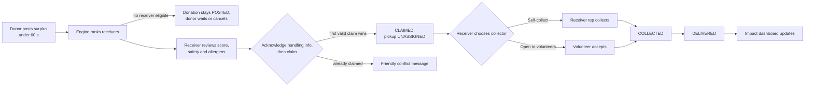
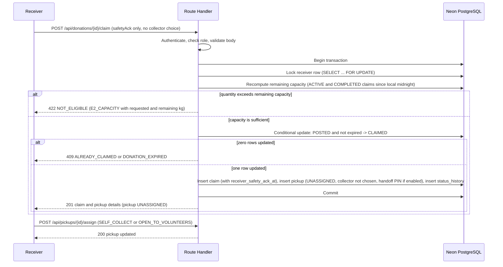
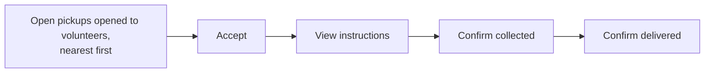
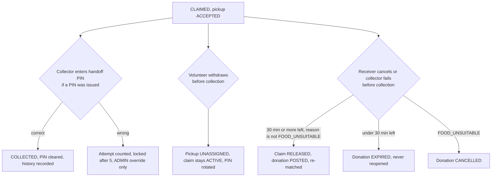
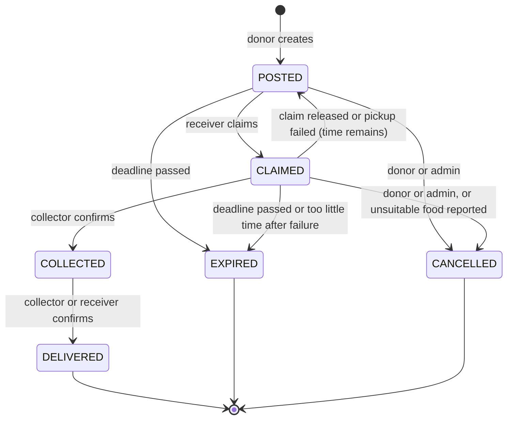

# SAVORUNE — Product Requirements Document

**Hackathon:** ACE Builders' Hackathon 2026 (CodeBenders) · **Problem Statement 2:** Society and Environment · **Challenge:** Rescue the Surplus
**Document version:** 1.2 (final targeted revision; see Revision history) · **Audience:** CodeBenders IDE (Nexen Guide), solo developer, hackathon judges
**Tagline:** "Every portion deserves a purpose."

> Priority legend used throughout: **P0** = mandatory hackathon MVP · **P1** = important if time permits · **P2** = future, outside the MVP.
>
> Status key used in tables: **Core** = required and built in the MVP · **Optional integration** = enabled by configuration; the app works fully without it · **Demo assumption** = a stated simplification for the hackathon demo · **Future** = documented but not built (P2).

### Revision history

| Version | Summary |
|---|---|
| 1.1 | Review and enhancement pass. |
| 1.2 | Six targeted corrections; no change to the technology stack, architecture, tables, priorities or the 36-hour scope. (1) Claim, collector-selection and volunteer-accept sequence made consistent everywhere (claim, then pickup `UNASSIGNED`, then self-collect or open to volunteers, then volunteer accept); `collectorType` removed from the claim request; volunteer limit applies only to volunteer acceptance; `pickups.collector_type` is nullable until chosen. (2) `claims.receiver_safety_ack_at` added to the existing `claims` table. (3) Volunteer acceptance locks the volunteer profile row, recalculates active pickups and assigns in one transaction; simultaneous-acceptance test added. (4) Handling guidance defined as centrally defined, pre-demo-reviewed, non-admin-editable application content. (5) No-eligible-receivers fallback defined. (6) Demo account count corrected to five logins; handoff PIN validity clarified (pickup open and before the collection deadline). |

---

## 1. Executive Summary

SAVORUNE is a food rescue and surplus redistribution platform. A restaurant posts surplus food in under 60 seconds; a deterministic matching engine ranks nearby NGOs, community kitchens and shelters; one receiver claims it; a volunteer (or the receiver) collects and delivers it; and an impact dashboard counts only food that was actually delivered, with every assumption shown.

**The five mandatory requirements, and where they live in this PRD**

| # | Mandatory requirement | P0 delivery | Sections |
|---|---|---|---|
| 1 | Donor flow under 60 seconds | Quick Donation form with presets, defaults, one-tap chips | 9 (FR-C), 11, 30 |
| 2 | Smart matching (distance, quantity, timing, need) | Deterministic weighted scoring with eligibility filters and plain-language explanations | 9 (FR-E), 14 |
| 3 | Pickup coordination with live status POSTED → CLAIMED → COLLECTED → DELIVERED | Transactional lifecycle, volunteer/self-collect, status history, polling-based live updates | 9 (FR-F), 15 |
| 4 | Impact dashboard with assumptions | Metrics from DELIVERED records only, configurable assumptions, methodology panel | 9 (FR-G), 20 |
| 5 | Handling and safety info per donation | Time window, storage, allergens, handling guidance, disclaimer, acknowledgments | 9 (FR-H), 21 |

**Guardrails honored:** SAVORUNE connects people and never certifies food safety; no tax or legal-benefit promises; synthetic data only; no real addresses or personal details (locations are picked from seeded synthetic zones, never typed addresses).

### 1.1 Documented MVP Assumptions

| ID | Assumption | Rationale |
|---|---|---|
| A1 | Launch scope is one compact Hyderabad area using **synthetic** coordinates inside a bounding box (lat 17.38–17.50, lng 78.32–78.46) | Keeps matching meaningful and demo-able |
| A2 | Donor type is **restaurants** only | Per brief; simplest surplus pattern |
| A3 | Volunteer accept/collect/deliver is built as **P0-lite**: self-accept from an open list, collect, deliver. Auto-suggesting volunteers, conflict smarts and notifications are P1 | Acceptance criteria 7–8 require a volunteer path; the P1 label in the brief covers the advanced parts |
| A4 | A receiver may choose **self-collect after claiming** (the claim itself never carries a collector choice), in which case the receiver's representative acts as collector | Removes the dependency on volunteer availability during the demo |
| A5 | "Live status" = **polling every 10 seconds** plus client-side countdown timers; no WebSockets | Simplest reliable approach on Vercel |
| A6 | An extra table `impact_settings` stores configurable assumptions (the brief lists 9 tables; this is the 10th) | Brief requires "configurable calculation assumptions" |
| A7 | Location is chosen from a **seeded list of synthetic zones**, not typed | Guarantees no real addresses are collected |
| A8 | Food-handling guidance text is **centrally defined application content** (one shared content module, one entry per `storage_condition`), reviewed against public guidance (e.g., FSSAI, WRAP/FAO) before the demo and **not admin-editable** in the MVP; there is no configuration table or settings screen for it. Any CO₂e factor remains a configurable placeholder in `impact_settings` and is shown only when an admin enters a cited factor | Avoids presenting unverified numbers as fact |
| A9 | ADMIN accounts are created only through a server-side bootstrap (environment allowlist of Clerk user IDs or the seed script) | Satisfies "no self-assigned ADMIN" |
| A10 | In-app notifications only for P0; email via Resend and background workflows via Trigger.dev are P1 and optional | Minimal infrastructure |
| A11 | The handoff PIN (P1) is a 6-digit, server-generated, short-lived code stored on the `pickups` row and nulled when the pickup closes. It is valid only while its pickup is open and uncollected and only before the collection deadline (FR-F10). It is a demo-grade handoff check, not a security credential | Reuses existing tables; no separate verification table |
| A12 | Urgency labels (P1) are derived from existing constants (30-minute handling buffer and 60-minute full-slack value, Section 14.1). They are logistics indicators and are **not** food-safety thresholds | Avoids inventing thresholds |
| A13 | "Food weight delivered" is the **recorded (donor-declared) quantity** of a DELIVERED donation; weight is not measured at handover | Honest labeling of recorded versus estimated |
| A14 | "Estimated food waste avoided" assumes the delivered surplus would otherwise have been discarded. This is an assumption, not a measurement | Transparent methodology |
| A15 | Notification emails (P1) resolve the recipient address from Clerk at send time; no email address is copied into application tables | Preserves FR-B7 |
| A16 | A fourth seeded receiver, Lakeside Food Bank (seed-only, no demo login), holds the claims for D5 and D6 (35 kg of its 50 kg capacity), so the other three receivers start the demo with nothing committed and the worked example in Section 14.5 stays valid under capacity-aware matching | Keeps demo numbers, tests and acceptance criteria consistent |
| A17 | The claim request carries no collector choice. A claim creates the pickup as UNASSIGNED with `collector_type` unset (null). The receiver then calls the pickup assign endpoint: `OPEN_TO_VOLUNTEERS` sets `collector_type` = VOLUNTEER (the pickup becomes visible to volunteers); `SELF_COLLECT` sets `collector_type` = RECEIVER and moves the pickup to ACCEPTED with no volunteer. Either choice is made while the pickup is UNASSIGNED and no volunteer has accepted; a receiver who chose self-collect cannot switch back and may cancel the claim instead (Section 15.4). This reuses existing columns and statuses; the only schema consequence is that `pickups.collector_type` is nullable | Removes the ambiguity of a claim-time `collectorType` |
| A18 | When no receiver is eligible, the donor sees only aggregate, non-identifying exclusion reasons (reason category and count); receiver names, capacities and profile data are never shown to donors (consistent with Section 14.6) | Explains the empty state without leaking receiver data |

---

## 2. Product Vision

**Vision:** Make surplus food rescue as easy as posting a message, so no edible portion is wasted while a neighbour goes hungry.

**Mission:** Connect donors, receivers and volunteers inside the short window before food spoils, and make the resulting impact transparent and credible.

**Product principles**
1. **Speed beats completeness.** Every donor interaction is optimized for under a minute.
2. **Explainable, not magical.** Every match and every metric shows its reasoning or assumptions.
3. **Honest about safety.** SAVORUNE connects people; it never certifies food.
4. **Count only what happened.** Impact is calculated from DELIVERED records.
5. **Privacy by design.** Synthetic locations, no personal contact details stored.

---

## 3. Problem Definition

Restaurants, caterers, venues, messes and canteens routinely discard edible food while nearby NGOs, kitchens and shelters struggle to feed people. The gap is not goodwill; it is **speed and coordination**. Surplus is known only hours before it spoils, donors cannot spare time on phone calls, receivers do not know what is available nearby, and nobody has a trustworthy way to see what was actually delivered.

| Pain | Who feels it | SAVORUNE response |
|---|---|---|
| No fast way to offer surplus | Donor | 60-second posting flow |
| No visibility into nearby supply | Receiver | Ranked, filterable discovery with match scores |
| Food spoils during coordination | All | Deadlines, countdowns, auto-expiry, feasibility filters |
| Pickups fall through | Donor, receiver | Claim locking, volunteer assignment, failure handling |
| Impact claims are unverifiable | Sponsors, admins | Metrics from delivered records with stated assumptions |

---

## 4. Goals and Non-Goals

### 4.1 Goals
- G1: Publish a donation in under 60 seconds (median target under 40 seconds).
- G2: Rank suitable receivers transparently with a 0–100 score and a plain-language reason.
- G3: Complete the lifecycle POSTED → CLAIMED → COLLECTED → DELIVERED with no double claims.
- G4: Show meals saved and food waste avoided with visible assumptions.
- G5: Show time window, storage, allergens and handling guidance on every donation.
- G6: Ship a reliable, deployable, demo-ready monolith on Vercel within 36 hours, solo.

### 4.2 Non-Goals (for the hackathon MVP)
- Real payments, subscriptions or invoicing (P2).
- Certifying food safety, temperature logging or inspections.
- Tax, CSR-eligibility or legal-benefit claims.
- Real addresses, phone numbers, route optimization, live GPS tracking.
- External LLMs or paid APIs in any core path.
- Native mobile apps, microservices, queues, or multi-city coverage.
- Scientifically verified environmental accounting.

---

## 5. Product Identity and Branding

| Item | Value |
|---|---|
| Name | SAVORUNE |
| Primary tagline | "Every portion deserves a purpose." |
| Secondary statement | "Smart food rescue. Meaningful connections. Measurable impact." |
| Positioning | A smart food rescue and surplus redistribution platform connecting restaurants, NGOs, community kitchens, shelters and volunteers |
| Personality | Premium, modern, technology-driven, sustainable, trustworthy, community-focused, impact-oriented |

### 5.1 Design Tokens

| Token | Hex | Usage |
|---|---|---|
| Forest (primary) | #102B24 | Headings, nav, hero background, primary text on light |
| Natural green (secondary) | #1F6B4D | Primary buttons, links, charts |
| Fresh lime (accent) | #A3D977 | Highlights, positive indicators, text on dark green |
| Warm orange (accent) | #F2A65A | Urgency, countdown warnings, secondary charts |
| Background | #F2F6EF | App background |
| Surface | #FFFFFF | Cards, forms |

**Typography:** Manrope (headings), Inter (body), JetBrains Mono (numbers, IDs, timestamps, scores). Load via `next/font`.

**Accessibility notes on color:** lime (#A3D977) and orange (#F2A65A) have low contrast on white, so use them for fills, icons and text on forest green only, never as body text on white. Do not rely on color alone for status; pair every status color with an icon and label.

**Visual language:** polished SaaS: generous spacing, rounded cards, subtle shadows, status chips, countdown rings, clean data visualizations. Avoid stock NGO imagery and dense legacy dashboards.

---

## 6. Target Audience

| Segment | Role | Initial scope |
|---|---|---|
| Surplus food donors | DONOR | Restaurants (fictional), Hyderabad demo area |
| Food receivers | RECEIVER | NGOs, community kitchens, shelters (fictional) |
| Volunteers | VOLUNTEER | Individuals who collect and deliver (fictional) |
| Platform administrators | ADMIN | SAVORUNE operators |
| Secondary audiences (viewers of impact data) | n/a in MVP | CSR sponsors, city sustainability teams (P2 portals) |

---

## 7. User Personas

### 7.1 Persona 1: Food Donor — "Meera, restaurant manager" (fictional)

| Attribute | Detail |
|---|---|
| Goals | Post surplus in seconds, know someone will collect it before it spoils, see her restaurant's contribution |
| Responsibilities | Accurate quantity, deadline, storage, allergens; hand over food to the collector |
| Permissions | Create, view, edit (while POSTED) and cancel own donations; view own pickups and impact; cannot see other donors' data |
| Journey | Sign in → Quick Donation → see top matches and countdown → receiver claims → collector arrives → donation marked delivered → impact updates |
| Dashboard | Active, claimed, completed, expired lists; contribution impact; "Post surplus" primary button |
| Device | Mobile first (posting during a rush), desktop for history |
| Important info | Pickup deadline, claim status, who is collecting (organization/first name only), safety disclaimer |

### 7.2 Persona 2: Food Receiver — "Ravi, community kitchen coordinator" (fictional)

| Attribute | Detail |
|---|---|
| Goals | Find suitable food nearby quickly, claim confidently, arrange collection |
| Responsibilities | Declare capacity, dietary policy and allergen avoidance accurately; inspect food on receipt; confirm delivery |
| Permissions | View available donations that pass eligibility; claim; release own claim; assign/self-collect; view own claims and history |
| Journey | Sign in → Recommendations → open details (safety, allergens, score reasons) → acknowledge handling → claim → choose self-collect or open to volunteers → confirm delivery |
| Dashboard | Recommended donations, active claims, pickup tracker, history |
| Device | Mobile and desktop equally |
| Important info | Distance, deadline countdown, quantity vs capacity, allergens, storage, match score and reasons |

### 7.3 Persona 3: Volunteer — "Asha, weekend volunteer" (fictional)

| Attribute | Detail |
|---|---|
| Goals | Find pickups she can reach in time and complete them with minimal friction |
| Responsibilities | Accept only pickups she can complete; confirm collection and delivery honestly |
| Permissions | View open pickups (UNASSIGNED pickups the receiver has opened to volunteers); accept; view own assigned pickups with instructions; update status for her own pickups only; withdraw from an accepted pickup before collection (P1) |
| Journey | Sign in → Open pickups sorted by distance → Accept → view instructions → Confirm collected → Confirm delivered |
| Dashboard | Open pickups, my active pickups, completed count |
| Device | Mobile only in practice |
| Important info | Deadline, from/to zone labels and synthetic pins, storage and allergen notes, one-tap status buttons |

### 7.4 Persona 4: Platform Administrator — "Nikhil, operations lead" (fictional)

| Attribute | Detail |
|---|---|
| Goals | Keep the platform healthy and demonstrate impact |
| Responsibilities | Monitor users, donations, pickups and expiries; manage demo data |
| Permissions | Read all data; suspend/reactivate users; cancel donations; reset or seed demo data; edit impact assumptions |
| Journey | Sign in → Admin dashboard → inspect expired or stuck pickups → review analytics |
| Dashboard | Platform KPIs, expired listings, stuck pickups, user table, impact |
| Device | Desktop |
| Important info | Platform-wide counts, anomalies (claimed but not collected near deadline), assumption settings |

### 7.5 Role-Based Access Control Matrix

| Capability | Public | DONOR | RECEIVER | VOLUNTEER | ADMIN |
|---|---|---|---|---|---|
| View landing page, public SEO pages | ✔ | ✔ | ✔ | ✔ | ✔ |
| Complete onboarding (choose DONOR/RECEIVER/VOLUNTEER) | | ✔ | ✔ | ✔ | n/a |
| Create donation | | ✔ | | | |
| Edit/cancel own donation (while allowed) | | ✔ | | | ✔ (cancel any) |
| View available donations (eligible, public-safe fields) | | | ✔ | | ✔ |
| View exact pickup instructions and synthetic map pin | | own | claimant only | assigned only | ✔ |
| Claim / release donation | | | ✔ | | |
| Choose self-collect or open to volunteers (claimant, after claiming); assign collector (P1) | | | ✔ | | ✔ |
| Accept open pickup (opened to volunteers) | | | | ✔ | |
| Confirm collected / delivered | | | own claim (self-collect or receipt) | assigned only | ✔ (override, logged) |
| View handoff PIN (P1) | | own donation | | | ✔ |
| Enter handoff PIN to confirm collection (P1) | | | claimant, self-collect only | assigned only | ✔ (override, logged) |
| Cancel an assignment before collection (P1) | | | claimant | assigned only (withdraw or report failure) | ✔ |
| View own impact | | ✔ | ✔ | ✔ (own count) | ✔ |
| View platform analytics and user management | | | | | ✔ |
| Reset demo data, edit assumptions | | | | | ✔ |

All permissions are enforced **server-side** (Section 18). The UI hides actions a role cannot perform, but hiding is cosmetic only.

---

## 8. User Stories

| ID | Priority | Story | Key acceptance hook |
|---|---|---|---|
| US-01 | P0 | As a donor, I post surplus in under 60 seconds so I can finish my shift | AC-1 |
| US-02 | P0 | As a donor, I declare storage and allergens so receivers can judge suitability | AC-12 |
| US-03 | P0 | As a donor, I see my donations by status and cancel while still allowed | AC-9 |
| US-04 | P0 | As a receiver, I see ranked recommendations with reasons | AC-3, AC-4 |
| US-05 | P0 | As a receiver, I filter by distance, category, quantity, deadline and diet | FR-D3 |
| US-06 | P0 | As a receiver, I claim a donation and no one else can | AC-5, AC-6 |
| US-07 | P0 | As a receiver, after claiming, I choose self-collect or open the pickup to volunteers | FR-F4 |
| US-08 | P0 | As a volunteer, I see open pickups sorted by distance and accept one | AC-7 |
| US-09 | P0 | As a volunteer, I confirm collection and delivery | AC-8 |
| US-10 | P0 | As any user, I see countdown timers and live status | FR-F8 |
| US-11 | P0 | As a viewer, I see meals saved and waste avoided with assumptions | AC-11 |
| US-12 | P0 | As a user, I see a safety disclaimer and handling guidance everywhere food is shown | AC-12 |
| US-13 | P0 | As the platform, I block unauthorized access by role | AC-13 |
| US-14 | P1 | As an admin, I monitor users, donations, pickups and expired listings | FR-I |
| US-15 | P1 | As a donor, I repeat my last donation with one tap and review it before publishing | FR-C9, AC-23 |
| US-16 | P1 | As a user, I see donations and pickups on a map | FR-D8 |
| US-17 | P1 | As a donor or receiver, I get an email on claim, collection and delivery | FR-N1 |
| US-18 | P2 | As a CSR sponsor, I view verified impact reports | Section 22 |
| US-19 | P1 | As a donor and a collector, we confirm the handoff with a short PIN so only the right person completes collection | FR-F10, AC-18, AC-19 |
| US-20 | P1 | As a receiver or volunteer, I cancel an assignment I cannot complete and the donation is re-offered if time remains | FR-F11, AC-20, AC-21 |
| US-21 | P1 | As a receiver, I see URGENT, EXPIRING SOON or AVAILABLE derived from the real collection deadline | FR-F12, AC-22 |

---

## 9. Functional Requirements

### Module A: Public Landing Page (P0)
| ID | Requirement |
|---|---|
| FR-A1 | Hero shows the tagline "Every portion deserves a purpose.", a one-sentence value statement and two CTAs: **"Donate surplus food"** (→ donor onboarding) and **"Receive food"** (→ receiver onboarding) |
| FR-A2 | Sections in order: problem, how it works (4 steps: Post, Match, Collect, Measure), for donors, for receivers, impact counters, safety and trust note, final CTA, footer with disclaimer |
| FR-A3 | Impact counters read from the database (delivered records only) and carry a visible "Synthetic demo data" label while only synthetic data exists |
| FR-A4 | Includes the full disclaimer (Section 21) in the footer |
| FR-A5 | Server-rendered, fast, SEO-complete (Section 27) |

### Module B: Authentication and User Management (P0)
| ID | Requirement |
|---|---|
| FR-B1 | Clerk handles registration, sign-in, sign-out and profile UI |
| FR-B2 | After first sign-in, an unonboarded user is redirected to `/onboarding`, selects DONOR, RECEIVER or VOLUNTEER, and completes a minimal profile (organization display name, synthetic zone, role-specific fields) |
| FR-B3 | The role is validated against an allowlist of {DONOR, RECEIVER, VOLUNTEER} server-side; ADMIN can never be chosen or submitted |
| FR-B4 | The application user (role, status) is stored in Neon PostgreSQL, keyed by Clerk user ID; the database is the source of truth for role |
| FR-B5 | Protected routes enforced by Clerk middleware **and** re-checked in every Route Handler, Server Action and data function |
| FR-B6 | Suspended users (status SUSPENDED) are denied all protected actions |
| FR-B7 | Personal data minimization: store Clerk ID, display name, role; no phone, email copy or street address in application tables |

### Module C: Donor Portal (P0)
| ID | Requirement |
|---|---|
| FR-C1 | **P0 refinement:** dashboard (role content in Section 11.7) with tabs Active (POSTED), Claimed (CLAIMED/COLLECTED), Completed (DELIVERED), Expired/Cancelled. Active cards show status, quantity, category and collection deadline (with the urgency label once FR-F12 exists). Contribution impact cards. Primary actions: "Post surplus" and, in P1, "Repeat last donation" |
| FR-C2 | Quick Donation form (spec below) |
| FR-C3 | After submit: success state showing the donation, countdown and, when at least one receiver is eligible, the number of eligible receivers and the best match score. The success state confirms that the donation is **posted**, never that it is matched; when no receiver is eligible it shows the no-eligible-receivers state of FR-E10 |
| FR-C4 | Donation details page with status timeline, collector name (display name only), and safety information. For the owning donor and ADMIN only, and only while the pickup is open, it also shows the handoff PIN (P1, FR-F10) |
| FR-C5 | Donor may edit non-critical fields only while POSTED; quantity and deadline edits re-run matching |
| FR-C6 | Donor may cancel while POSTED or CLAIMED (not after COLLECTED) with a reason. Cancelling a CLAIMED donation closes the claim and pickup in one transaction (Section 15.4) |
| FR-C7 | Donor impact summary: total delivered kg, meals, donation count, trend |
| FR-C8 | Donation history with pagination |
| FR-C9 | **P1:** "Repeat last donation" opens the Quick Donation form prefilled from the donor's most recent donation as **editable defaults**: title, category, diet, quantity, estimated servings, storage condition, allergen status and allergens, pickup instructions. It never publishes automatically; the donor reviews and explicitly submits. **Not copied:** status, claim, pickup, delivery data, handoff PIN, `prepared_at`, `safety_ack_at`, `cancel_reason`, timestamps. The pickup deadline resets to the default (+3 h) because the old absolute time is stale. Prefilled allergen values are labeled "Review before posting" and are not treated as verified. The safety acknowledgment starts unchecked and every field is validated again server-side by the normal `POST /api/donations`. Happy path of at most 5 interactions keeps the under-60-second goal |

**Quick Donation form specification**

| Field | Control | Required | Default | Validation |
|---|---|---|---|---|
| Food name | Text with preset chips (e.g., "Veg biryani", "Dal & rice", "Bread & buns") | Yes | none | 3–60 chars |
| Category | Segmented control: COOKED_MEAL, BAKERY, FRESH_PRODUCE, PACKAGED, OTHER | Yes | COOKED_MEAL | enum |
| Diet type | Toggle VEG / NON_VEG | Yes | VEG | enum |
| Quantity (kg) | Stepper plus quick chips (5, 10, 20, 50) | Yes | none | 0.5–500, step 0.5 |
| Estimated servings | Number | Yes | auto = round(kg × 1000 ÷ grams-per-meal), editable | integer 1–2000 |
| Prepared at | Time picker | No | blank | not in future; not more than 24 h ago |
| Pickup deadline | Chips: +1 h, +2 h, +3 h, +4 h, custom | Yes | +3 h | at least 30 min and at most 12 h from now |
| Storage condition | Segmented: HOT_HELD, CHILLED, AMBIENT, FROZEN | Yes | derived from category (cooked → HOT_HELD, bakery/packaged/other → AMBIENT, produce → CHILLED) | enum |
| Allergen status | 3 chips: "None declared", "Contains…", "Unknown" | Yes | **no default** (forces an explicit safety choice; one tap) | enum |
| Allergens | Multi-select chips: PEANUTS, TREE_NUTS, DAIRY, EGG, GLUTEN, SOY, FISH, SHELLFISH, SESAME, MUSTARD | Required if "Contains…" | none | values from fixed list; must be empty if "None declared" |
| Pickup instructions | Short text | No | template ("Collect at the kitchen back entrance; ask for the duty manager") | max 300 chars; **reject phone numbers and email addresses** by pattern |
| Safety acknowledgment | Checkbox | Yes | unchecked | must be true; timestamp stored |

**Speed budget:** at most 7 interactions on the happy path (name chip, quantity chip, deadline chip, allergen chip, acknowledgment, submit; category/diet/storage default sensibly). Playwright measures the scripted flow and must complete in under 60 seconds including page load.

### Module D: Receiver Portal (P0)
| ID | Requirement |
|---|---|
| FR-D1 | **P0 refinement:** dashboard (Section 11.7): recommended donations (top 5 by match score) with match explanations, remaining daily capacity (FR-E8), active claims, incoming pickup progress |
| FR-D2 | Available donations list/grid, default sort by match score, alternatives: soonest deadline, nearest |
| FR-D3 | Filters: distance (km slider), category, quantity range, pickup deadline (within 1/2/4 h), dietary suitability (veg only) |
| FR-D4 | Each card shows food name, category, quantity (kg), estimated servings, distance, deadline countdown with the urgency label (P1, FR-F12), storage, allergens, and a match score chip with a one-line reason why this receiver is suitable |
| FR-D5 | Donation details: full safety block, score breakdown with explanations, donor display name and zone label (no exact pin or instructions until claimed) |
| FR-D6 | Claim workflow: requires the handling acknowledgment checkbox (the server records it as `claims.receiver_safety_ack_at` when the claim commits), then an atomic claim (the receiver row is locked and remaining capacity is re-checked inside the transaction, FR-E8). The claim request carries no collector choice. On success the claim exists, the pickup is UNASSIGNED, and the pickup instructions and synthetic map pin are revealed; the receiver then chooses the collector (FR-F4) |
| FR-D7 | Claimant can release a claim before collection with a reason (returns donation to POSTED if enough time remains; never reopens an expired donation). Outcomes follow Section 15.4 |
| FR-D8 | **P1:** map of donations and receiver location (Leaflet/OpenStreetMap) |
| FR-D9 | History of claims and deliveries |

### Module E: Smart Matching Engine (P0)
See Section 14 for the full algorithm. Requirements:
| ID | Requirement |
|---|---|
| FR-E1 | Deterministic scoring: Final = Distance×0.30 + Quantity×0.25 + Timing×0.25 + Need×0.20, each factor 0–100 |
| FR-E2 | Eligibility filters run **before** scoring and return rejection reason codes plus a plain-language reason that includes the numbers involved (for example requested kg and remaining kg) |
| FR-E3 | Haversine distance on synthetic coordinates |
| FR-E4 | Every recommendation includes a human-readable explanation |
| FR-E5 | No external LLM or paid API |
| FR-E6 | Results persisted to `matches` as an auditable snapshot; score at claim time stored on the claim |
| FR-E7 | Volunteer open-pickup list (UNASSIGNED pickups the receiver has opened to volunteers, `collector_type` = VOLUNTEER) sorted by Haversine distance from the volunteer's zone (P0-lite). Self-collect pickups never appear in it |
| FR-E8 | **P0 refinement, capacity-aware eligibility:** remaining daily capacity is `daily_capacity_kg` minus the kg the receiver has already committed today (ACTIVE or COMPLETED claims since local midnight, Section 14.1), never the configured capacity alone. A donation larger than the remaining capacity is excluded (E2) with an explanation. The claim transaction recomputes capacity under a receiver row lock (Section 16.4), so concurrent claims cannot exceed it. The scoring formula and weights are unchanged |
| FR-E9 | Matching reads minutes-to-deadline from the same helper as the urgency labels (FR-F12) so lists, dashboards, details and matching agree. Urgency is display-only and is not a scoring factor |
| FR-E10 | **P0 refinement, no eligible receivers:** when no receiver passes the eligibility filters for a donation, the donation stays POSTED while its pickup deadline remains valid; matching never changes a donation's status and no receiver is assigned automatically. The donor sees a clear empty state (for example "Posted. No receiver can accept this donation right now.") with aggregate, non-identifying exclusion reasons in plain language (reason category and count derived from the E-codes, for example "2 receivers are out of range or cannot reach it in time; 1 cannot take 25 kg today"; no receiver names, capacities or profile data, A18), and two choices: **Wait** (the donation stays visible; receivers whose eligibility changes, for example because capacity is freed by a release, see it the next time they load recommendations, Section 14.6) or **Cancel** (FR-C6). The donor may also edit quantity or deadline (FR-C5), which re-runs matching. If the deadline passes the donation becomes EXPIRED as usual (BL-07). The UI never describes a posted donation as matched while the eligible count is 0. On the receiver side, an empty recommendations list uses the empty-state pattern of Section 11.8 and the "Show ineligible" toggle explains each exclusion with its numbers |

### Module F: Pickup Coordination (P0)
| ID | Requirement |
|---|---|
| FR-F1 | Lifecycle: POSTED → CLAIMED → COLLECTED → DELIVERED, plus EXPIRED and CANCELLED (Section 15) |
| FR-F2 | Claiming creates a claim (with `receiver_safety_ack_at`) and a pickup with status UNASSIGNED and `collector_type` unset, in one transaction, after re-checking remaining capacity under the receiver row lock (FR-E8); when the handoff PIN feature is on, the PIN is generated in the same transaction |
| FR-F3 | Only one ACTIVE claim per donation and at most one open pickup per donation (both database-enforced by partial unique indexes, Section 16.2) |
| FR-F4 | Sequence: receiver claims, then the pickup is created UNASSIGNED with no collector chosen, then the receiver chooses **Self-collect** or **Open to volunteers** through `POST /api/pickups/[id]/assign` (actions SELF_COLLECT and OPEN_TO_VOLUNTEERS), and only then may a volunteer accept. The choice is never part of the claim request. Until the receiver chooses, the pickup is not visible to volunteers. SELF_COLLECT sets `collector_type` = RECEIVER and moves the pickup to ACCEPTED (the receiver's representative is the collector); OPEN_TO_VOLUNTEERS sets `collector_type` = VOLUNTEER and leaves the pickup UNASSIGNED. The volunteer active-pickup limit (BL-11) applies only to volunteer acceptance and assignment, never to self-collect or to opening a pickup to volunteers |
| FR-F5 | Volunteer accepts an UNASSIGNED pickup that the receiver has opened to volunteers. Acceptance is atomic: in one transaction it locks the volunteer's `volunteer_profiles` row, recalculates the volunteer's active pickups and performs the assignment (Section 16.4). Receiver or admin may assign a specific volunteer (P1), subject to the same limit check |
| FR-F6 | Collector confirms COLLECTED then DELIVERED; each transition is validated server-side and logged to `status_history` with timestamp, actor and role |
| FR-F7 | Failed pickup with reason codes; outcome rules in Sections 15.4 and 23 |
| FR-F8 | Live status: client polls every 10 s on pickup screens; countdown timers computed client-side from server deadline |
| FR-F9 | Expiry: lazy expiry on reads/writes plus an optional scheduled sweep (Section 25) |
| FR-F10 | **P1, optional if time is short, handoff PIN:** when a claim is created and `HANDOFF_PIN_ENABLED` is true (a code constant, Section 14.1), the server generates a 6-digit PIN with a cryptographically secure generator and stores it on the pickup. Only the owning donor and ADMIN can view it. It is never returned to receivers or volunteers, never present in listing endpoints, `matches`, logs, emails or `status_history`. To confirm COLLECTED, the assigned volunteer (or the claimant receiver in self-collect) enters the PIN the donor reads out at handover, and the server validates it inside the transition transaction. The PIN is valid only while its pickup is open and uncollected: a verification is accepted only when the pickup is ACCEPTED and the collection deadline (`pickup_deadline`) has not passed, checked on the database clock inside the same transaction; at or after the deadline the PIN cannot be used, the donation becomes EXPIRED and the PIN is cleared (an ADMIN override cannot reopen an expired donation). A wrong PIN is rejected and counted; after 5 failures the PIN is locked and only an ADMIN override (logged) can complete collection. Success records `handoff_verified_at`, clears the PIN and writes the history entry; a repeat confirmation returns 409. The PIN is also cleared on delivery, failure, cancellation and expiry, and rotated when a volunteer withdraws. If the feature is off or a pickup has no PIN, collection works exactly as in P0 |
| FR-F11 | **P1, cancellation and recovery:** before COLLECTED, the claimant receiver or the assigned collector may cancel their part with a reason; the reason and timestamp are recorded. A volunteer who withdraws returns the pickup to UNASSIGNED for reassignment while the claim stays ACTIVE. A receiver release or a collector failure closes the claim; the donation returns to POSTED and is re-matched only if at least 30 minutes remain, otherwise it becomes EXPIRED. An EXPIRED, CANCELLED or DELIVERED donation is never reopened. Previous status history is preserved. Details in Section 15.4 |
| FR-F12 | **P1, urgency labels:** URGENT, EXPIRING SOON and AVAILABLE are derived by one shared pure function from `pickup_deadline`, the current time and the existing constants (Section 14.8). The same result appears on listing cards, dashboards, details and matching inputs. Each label has an icon and text, never color alone. Expired donations show the EXPIRED status chip instead and cannot be claimed (BL-02) |
| FR-F13 | **P0 refinement, volunteer dashboard essentials:** available pickups (nearest first), accepted assignments with pickup deadlines and assignment status, and one-tap Collect and Deliver actions (Section 11.7) |

### Module G: Impact Dashboard (P0)
| ID | Requirement |
|---|---|
| FR-G1 | KPIs: successfully delivered donations (count, recorded), food weight delivered (kg rescued, recorded), estimated meals saved, estimated food waste avoided (kg). Each KPI shows its unit and a "Recorded" or "Estimate" label |
| FR-G2 | Donor contribution ranking (by delivered kg) |
| FR-G3 | Completion trend chart (delivered kg per day, last 14/30 days) with Recharts |
| FR-G4 | All metrics computed from DELIVERED donations only; POSTED, CLAIMED, COLLECTED, EXPIRED and CANCELLED donations are never counted as completed impact |
| FR-G5 | Assumptions (grams per meal, etc.) read from `impact_settings`, editable by ADMIN |
| FR-G6 | "How we calculate this" panel on every impact view showing formulas, units and assumptions. Estimated metrics are labeled "Estimate", recorded metrics "Recorded", and the data origin "Synthetic demo data" while only synthetic data exists (Section 20) |
| FR-G7 | **P1:** optional CO₂e estimate using a configurable, cited factor, labeled as an estimate |
| FR-G8 | No CO₂e or other environmental claim is displayed unless an admin has entered a factor and a source note; otherwise the field is hidden, not shown as zero |

### Module H: Food Safety and Handling (P0)
| ID | Requirement |
|---|---|
| FR-H1 | Every listing card and detail page shows pickup deadline, preparation time (if known; otherwise "Preparation time not provided", never presented as verified), storage condition, allergens and generated handling guidance |
| FR-H2 | Required disclaimer text (Section 21) shown on the donation form, listing detail, claim dialog, pickup screens, impact page and footer |
| FR-H3 | Donors acknowledge responsibility before posting (`donations.safety_ack_at`); receivers explicitly acknowledge the food-handling information before claiming, recorded as `claims.receiver_safety_ack_at` |
| FR-H4 | UI never uses words like "safe", "certified", "guaranteed" to describe listed food |
| FR-H5 | Allergen status "Unknown" is displayed prominently as a warning |
| FR-H6 | Urgency labels and countdowns are logistics indicators only; no UI copy implies that food is safe until a deadline or unsafe after it (Section 21.3) |
| FR-H7 | **Handling guidance content:** the food-handling guidance shown under FR-H1 and Section 21.2 is centrally defined application content (one shared content module, one entry per storage condition), reviewed against public guidance before the demo (A8). It is not stored in the database, is not admin-editable in the MVP, and has no configuration table or settings feature. All disclaimers in Section 21.1 are unchanged |

### Module I: Admin Dashboard (P1, with a minimal P0 read-only view if time allows)
| ID | Requirement |
|---|---|
| FR-I1 | User table with role/status; suspend and reactivate |
| FR-I2 | Donation monitor with filters (status, date, donor) |
| FR-I3 | Pickup monitor highlighting stuck pickups (CLAIMED with deadline under 30 minutes and no collection) |
| FR-I4 | Expired donations view |
| FR-I5 | Platform analytics (same impact math, platform-wide) |
| FR-I6 | Synthetic demo data: seed and reset actions, admin-only, with confirmation |
| FR-I7 | Edit impact assumptions |
| FR-I8 | Failed pickups view: pickups with status FAILED or CANCELLED, with reason, time and outcome (re-offered, expired or cancelled), read from `pickups`, `claims` and `status_history` |
| FR-I9 | Admin overview: platform activity counts by donation status, active versus expired donations, stuck and failed pickups, basic user and donation monitoring (Section 11.7). It reads existing tables only |

### Module N: Notifications (P1)
| ID | Requirement |
|---|---|
| FR-N1 | **P1, optional integration:** Resend emails for the events in Section 17.4 (donation claimed, pickup assigned, collection confirmed, delivery completed, expiry reminder), sent only by a server-side notification service, never from client components. Disabled gracefully when `RESEND_API_KEY` is missing |
| FR-N2 | In-app status banners are P0; they use polling, not push |
| FR-N3 | Each event is sent at most once. The idempotency key is the event type plus the `status_history` row id (or the donation id for expiry reminders); no new table is needed (Section 17.4) |
| FR-N4 | Notifications are triggered after the database transaction commits. A failed notification never rolls back or blocks a state change. Retries use Trigger.dev when it is enabled; otherwise a failure is logged and not retried |

---

## 10. Non-Functional Requirements

| Area | Requirement | Target |
|---|---|---|
| Performance | Landing page LCP | under 2.5 s on a throttled mobile profile |
| Performance | API p95 for list/match endpoints on demo data | under 500 ms |
| Responsiveness | Layouts for 360 px mobile to 1440 px desktop; mobile-first for donor posting and volunteer screens | verified in Playwright at two viewports |
| Security | Clerk authentication; server-side RBAC on every route; authorization check on every state-changing operation; atomic claims and pickup transitions; duplicate-request protection; safe error messages; no secrets in client bundles; Zod validation on all inputs; parameterized queries via Drizzle | no unauthenticated write endpoints; Section 18.1 checklist |
| Integrity | Foreign keys, enums, unique and partial unique indexes, transactions for multi-row changes | zero orphan rows; zero double claims |
| Error handling | Uniform JSON error envelope; user-friendly messages; no stack traces to clients | Section 17.1 |
| Accessibility | WCAG 2.1 AA target: contrast, focus rings, labels, keyboard operation, `aria-live` for status changes, reduced-motion support | axe checks on core pages |
| Maintainability | Single Next.js monolith, feature folders, shared Zod schemas, pure functions for matching/impact/transitions | unit-testable logic isolated from I/O |
| SEO | Per Section 27 | |
| Privacy | Data minimization, synthetic data only, no personal contact fields, DPDP-aware design (Section 21) | |
| Reliability | `next build` and type-check pass on Vercel; migrations reviewed before apply | |
| Observability | Structured server logs with request IDs; status_history as business audit log | |
| Resilience | Optional services (Trigger.dev, Resend, Leaflet/OpenStreetMap, Sentry, Upstash) are never hidden dependencies of a mandatory workflow; Clerk and Neon failures fail safely (Section 19.3) | Verified by AC-27 to AC-30 |
| UX states | Skeleton loading, actionable empty and error states, explicit success confirmation, reduced-motion support, mobile-first pickup and claim actions (Section 11.8) | Verified by AC-31 |

---

## 11. Screen-by-Screen Specifications

**Global:** consistent top navigation (logo, role-appropriate links, user menu) on desktop; bottom tab bar on mobile for DONOR, RECEIVER and VOLUNTEER. Every data screen defines **loading** (skeletons), **empty** (illustration plus next action), **error** (retry) and **success** (toast or banner) states. A persistent footer carries the disclaimer.

### 11.1 Public
| Route | Purpose | Key content |
|---|---|---|
| `/` | Landing | Modules A1–A5; role-specific CTAs |
| `/sign-in`, `/sign-up` | Clerk-hosted components styled to brand | noindex |
| `/onboarding` | Role selection and minimal profile | Role cards (3 only), org display name, synthetic zone picker, role-specific fields |

**Onboarding profile fields**
- Donor: business display name, zone, default pickup instructions.
- Receiver: organization display name, type (NGO / COMMUNITY_KITCHEN / SHELTER), zone, daily capacity (kg), diet policy (ANY / VEG_ONLY), avoided allergens, preferred categories, need level (1–5).
- Volunteer: display name, zone (home base), availability note (optional, max 100 chars; no contact details).

### 11.2 Donor
| Route | Screen | Key content and actions |
|---|---|---|
| `/donor` | Dashboard | Section 11.7: active donations with deadline and urgency, status tabs, completed history, "Post surplus" and (P1) "Repeat last donation" |
| `/donor/donations/new` | Quick donation form | Section 9 spec; safety disclaimer; submit. `?repeat=last` (P1) prefills editable defaults and never auto-publishes |
| `/donor/donations` | My donations | Filter by status, search by name, pagination |
| `/donor/donations/[id]` | Donation details | Status timeline, countdown and urgency label, safety block, top matches (or the no-eligible-receivers state, FR-E10), cancel/edit, handoff PIN card (P1, owner only) |
| `/donor/donations/[id]/pickup` | Pickup status | Live stepper POSTED → CLAIMED → COLLECTED → DELIVERED with timestamps; failed or cancelled attempts and PIN-confirmed handoff shown as timeline events |
| `/donor/impact` | Impact summary | KPIs, trend chart, methodology panel |

### 11.3 Receiver
| Route | Screen | Key content and actions |
|---|---|---|
| `/receiver` | Dashboard | Section 11.7: top 5 recommendations with explanations, remaining daily capacity meter, claimed donations, incoming pickup progress |
| `/receiver/donations` | Available donations | Filters (FR-D3), sort, cards with match chips |
| `/receiver/recommendations` | Smart recommendations | Ranked list with score breakdown bars and one-line explanation; "Show ineligible" toggle explains each exclusion (for example "Needs 25 kg but your remaining capacity today is 20 kg") |
| `/receiver/donations/[id]` | Donation details | Safety block, allergens, score reasons, claim CTA |
| `/receiver/donations/[id]/claim` | Claim workflow | Acknowledgment, then confirm the claim; after the claim succeeds a second step offers the collector choice (self-collect or open to volunteers), and until it is made the pickup stays UNASSIGNED and is not visible to volunteers; a capacity rejection shows the numbers and a way back to recommendations |
| `/receiver/pickups` | Pickup tracking | Active claims with live stepper; confirm delivery; cancel claim with reason; PIN entry for self-collect (P1) |
| `/receiver/history` | History | Past claims |

### 11.4 Volunteer
| Route | Screen | Key content and actions |
|---|---|---|
| `/volunteer` | Dashboard | Section 11.7: available pickups (nearest first), accepted assignments, pickup deadlines, assignment status, Collect and Deliver actions |
| `/volunteer/pickups` | Assigned pickups | List with status chips |
| `/volunteer/pickups/[id]` | Assignment details | From/to zone labels, pins, deadline, instructions, storage/allergen notes; "I can't do this pickup" (withdraw with reason, P1) |
| `/volunteer/pickups/[id]/collect` | Collection confirmation | Large "Confirm collected" button, safety reminder; 6-digit PIN field with numeric keypad when the pickup holds a PIN (P1) |
| `/volunteer/pickups/[id]/deliver` | Delivery confirmation | Large "Confirm delivered" button, optional note |

### 11.5 Admin (P1)
| Route | Screen | Key content |
|---|---|---|
| `/admin` | Dashboard | KPIs, platform activity overview, active versus expired donations, failed and stuck pickups |
| `/admin/users` | User management | Table, suspend/reactivate |
| `/admin/donations` | Donation monitoring | Filters, cancel action |
| `/admin/pickups` | Pickup monitoring | Stuck and failed pickups highlighted with reason and outcome |
| `/admin/impact` | Impact analytics | Platform-wide; assumptions editor |
| `/admin/demo` | Demo data | Seed, reset (confirm dialog) |

### 11.6 Shared components
Status chip, countdown ring (orange under 30 min), urgency badge (icon plus text, P1), match-score chip with breakdown popover and reason line, remaining-capacity meter, safety card, disclaimer banner, status timeline (stepper with timestamps), handoff PIN card and PIN input (P1), empty/error/skeleton states, toast, confirm dialog.

### 11.7 Role-specific dashboard content

Dashboards read existing tables only (no dashboard-specific storage) through the existing endpoints, and show only data the role is authorized to see (BL-10, BL-16). "P0 essentials" are refinements of existing P0 screens; "P1 polish" is additional.

| Role | P0 essentials | P1 polish | Data source |
|---|---|---|---|
| DONOR | Active donations with status chip (POSTED, CLAIMED, COLLECTED, DELIVERED), quantity, category and collection deadline; completed donation history; contribution impact cards | Urgency label; "Repeat last donation" action; handoff PIN card | `GET /api/donations`, `GET /api/impact?scope=me` |
| RECEIVER | Nearby matching donations with a match explanation; remaining daily capacity ("X kg left of Y kg today"); claimed donations; incoming pickup progress stepper | Urgency labels; map view; "Show ineligible" reasons | `GET /api/matches` (with capacity meta), `GET /api/pickups` |
| VOLUNTEER | Available pickups (nearest first); accepted assignments; pickup deadlines; assignment status; Collect and Deliver actions | Urgency labels; withdraw action; PIN entry | `GET /api/pickups?scope=open\|mine` |
| ADMIN | Platform activity overview; active and expired donations; failed pickups; basic user and donation monitoring; demo reset (the admin dashboard is P1, with a minimal read-only P0 view if time allows) | Filters, anomaly highlights | `GET /api/admin/analytics`, admin list endpoints |

### 11.8 UX state and interaction standards

These refine the existing design direction (forest green and lime palette, Manrope and Inter, clean spacious layouts); they do not replace the design system. Avoid decorative dashboards and animation that does not communicate state; micro-interactions are purposeful and honor `prefers-reduced-motion`. Keyboard navigation and visible focus states apply everywhere.

| # | Element | Requirement |
|---|---|---|
| 1 | Match cards | Show the score, the two strongest reasons in plain language and any caution (for example an allergen), with the factor breakdown in a popover |
| 2 | Donation cards | Show quantity, category, collection deadline, urgency label (icon and text, P1), storage and allergen status |
| 3 | Status timelines | Show every lifecycle stage; the current stage is highlighted with icon and text; completed stages show timestamp and actor role; expired, cancelled and failed attempts appear as a labeled terminal branch with the reason |
| 4 | Safety information | Safety card is visible without scrolling on detail, claim and pickup screens; readable text size (at least 16 px); "Unknown" allergen status uses a warning icon and text |
| 5 | Dashboard cards | The first card is the role's primary action (Post surplus, Claim top match, Accept pickup, Review monitors); secondary data follows |
| 6 | Loading | Skeletons that match the final layout; no blank screens or spinner-only pages |
| 7 | Empty states | One sentence plus a next action, for example "No matching donations. Widen the distance or see why donations were excluded" |
| 8 | Error states | Say what happened, whether anything was saved, and offer a recovery action (retry, go back); never show stack traces or raw codes |
| 9 | Success states | Confirm the completed action, the new status and the next step, using a toast plus an `aria-live` announcement |
| 10 | Mobile | One-column layouts from 360 px; sticky bottom action bar for Post, Claim, Confirm collected and Confirm delivered; touch targets of at least 44 px; numeric keypad for quantity and PIN fields |

---

## 12. User Journey Diagrams

### 12.1 End-to-end rescue journey

### 12.2 Claim sequence

### 12.3 Volunteer journey

### 12.4 Handoff and recovery (P1 refinements)

---

## 13. Business Logic

| ID | Rule |
|---|---|
| BL-01 | Role comes only from the database user record; client-submitted roles are ignored except at onboarding, where only DONOR/RECEIVER/VOLUNTEER are accepted |
| BL-02 | A donation is **claimable** iff status = POSTED, pickup_deadline > now, and receiver passes all eligibility filters |
| BL-03 | At most one ACTIVE claim per donation (partial unique index plus conditional update) |
| BL-04 | Every status change goes through one server-side transition function that checks (current status, target status, actor role, actor ownership) against the transition table in Section 15 |
| BL-05 | Every status change writes a `status_history` row in the same transaction |
| BL-06 | Collection is allowed only before pickup_deadline; delivery has no deadline but is flagged "late" if after it |
| BL-07 | Expiry: any POSTED or CLAIMED donation with pickup_deadline ≤ now becomes EXPIRED (lazy on access, plus sweep) |
| BL-08 | Impact counts only DELIVERED donations |
| BL-09 | Servings default is derived from kg and grams-per-meal but is the donor's editable estimate; impact uses the configured grams-per-meal, not donor servings |
| BL-10 | Pickup instructions and the exact synthetic map pin (not the handoff PIN) are visible only to the claimant, the assigned collector, the donor and ADMIN |
| BL-11 | A volunteer may hold at most 2 active pickups (ACCEPTED or COLLECTED) concurrently (configurable). The limit is enforced only when a volunteer accepts or is assigned a pickup, under a lock on the volunteer's profile row (Section 16.4); it never applies to self-collection, where no volunteer is involved |
| BL-12 | Donor cannot claim their own donation (roles are exclusive, so enforced by role) |
| BL-13 | Free-text fields reject phone numbers and email patterns to protect privacy |
| BL-14 | A receiver cannot claim a donation exceeding its remaining daily capacity. The check is repeated inside the claim transaction under a receiver row lock (FR-E8); capacity shown in the UI is never trusted |
| BL-15 | Suspended users cannot create, claim, accept or update anything |
| BL-16 | Handoff PIN (P1): generated server-side at claim time; valid only while its pickup is open and uncollected and only before the collection deadline (a verification attempt at or after the deadline is rejected, Section 15.2); visible only to the owning donor and ADMIN; checked only on the server; locked after 5 wrong attempts; cleared on verification, delivery, failure, cancellation and expiry; rotated on volunteer withdrawal; never logged or emailed; a successful or repeated confirmation cannot be replayed |
| BL-17 | Recovery (P1 refinements; release and failure outcomes are P0): EXPIRED, CANCELLED and DELIVERED donations are never reopened. A released or failed pickup returns the donation to POSTED only if at least RECOVERY_MIN_REMAINING_MIN minutes remain on the database clock inside the same transaction. Earlier claims, pickups and history rows are never deleted or overwritten |
| BL-18 | Urgency (P1): the label is computed, never stored, by one shared function from `pickup_deadline`, the current time and the constants in Section 14.1; it is a logistics indicator, not a food-safety statement |
| BL-19 | At most one open pickup (UNASSIGNED, ASSIGNED, ACCEPTED or COLLECTED) exists per donation at any time |
| BL-20 | Collector selection: a claim never carries a collector choice. The pickup is created UNASSIGNED with `collector_type` unset; only then can the claimant RECEIVER choose SELF_COLLECT or OPEN_TO_VOLUNTEERS. Volunteers can see and accept only UNASSIGNED pickups with `collector_type` = VOLUNTEER. Self-collect pickups are never in a volunteer's list and never count toward a volunteer's active-pickup limit |
| BL-21 | Receiver acknowledgment: a claim is created only if the receiver explicitly acknowledged the food-handling information; the server sets `claims.receiver_safety_ack_at` from the database clock inside the claim transaction. A client-supplied timestamp is never accepted |
| BL-22 | No eligible receivers (FR-E10): the donation stays POSTED while its deadline is valid; matching never changes donation status; posting is never presented as a successful match |

---

## 14. Smart Matching Algorithm

### 14.1 Inputs
- **Donation:** pickup lat/lng (snapshot from donor profile), quantity_kg, pickup_deadline, category, diet type, allergen status and list.
- **Receiver profile:** lat/lng, daily_capacity_kg, remaining capacity today (`daily_capacity_kg` minus the summed `quantity_kg` of donations behind that receiver's ACTIVE or COMPLETED claims with `claimed_at` since local midnight in CAPACITY_TZ, never below 0; this is the existing rule stated precisely, because an ACTIVE claim means the donation is CLAIMED or COLLECTED and a COMPLETED claim means DELIVERED, while released, cancelled and expired claims do not count), diet policy, avoided allergens, preferred categories, need level (1–5).
- **Config constants** (centralized, editable in code or settings):

| Constant | Default | Meaning |
|---|---|---|
| MAX_RADIUS_KM | 10 | Beyond this the receiver is ineligible |
| D_FULL_KM | 0.5 | Distance at or under which distance score = 100 |
| AVG_SPEED_KMPH | 20 | Travel speed for feasibility |
| HANDLING_BUFFER_MIN | 30 | Fixed time for loading/hand-over |
| SLACK_FULL_MIN | 60 | Spare minutes at which timing score = 100 |
| QTY_BAND_MIN_RATIO | 0.5 | Lower edge of the ideal quantity band as a share of remaining capacity |
| SERVICE_BBOX | lat 17.38–17.50, lng 78.32–78.46 | Supported area |
| WEIGHTS | 0.30 / 0.25 / 0.25 / 0.20 | Distance / Quantity / Timing / Need |
| CAPACITY_TZ | Asia/Kolkata | Time zone whose local midnight starts the capacity day |
| RECOVERY_MIN_REMAINING_MIN | 30 | Minimum minutes to deadline for a released or failed pickup to be re-offered (the existing 30-minute rule; equals HANDLING_BUFFER_MIN by default) |
| URGENT_MAX_MIN | HANDLING_BUFFER_MIN (30) | At or below this many minutes to deadline the label is URGENT (Section 14.8) |
| EXPIRING_SOON_MAX_MIN | HANDLING_BUFFER_MIN + SLACK_FULL_MIN (90) | Below this the label is EXPIRING SOON; at or above it the label is AVAILABLE |
| HANDOFF_PIN_ENABLED | true when the P1 feature is built | Feature switch in code, not an environment variable |
| HANDOFF_PIN_LENGTH, HANDOFF_PIN_MAX_ATTEMPTS | 6, 5 | PIN size and lockout threshold |

### 14.2 Eligibility filters (run first; any failure rejects the pair)

| Code | Rejects when |
|---|---|
| E1_EXPIRED | donation status is not POSTED or pickup_deadline ≤ now |
| E2_CAPACITY | quantity_kg > receiver's remaining daily capacity (including quantities already claimed or collected today) |
| E3_NOT_FEASIBLE | minutes to deadline < estimated travel minutes + HANDLING_BUFFER_MIN |
| E4_DIET | receiver diet policy is VEG_ONLY and donation is NON_VEG |
| E5_ALLERGEN | donation allergens intersect the receiver's avoided allergens |
| E6_ALLERGEN_UNKNOWN | donation allergen status is UNKNOWN and the receiver has any avoided allergens |
| E7_OUT_OF_AREA | receiver or donation coordinates missing, outside SERVICE_BBOX, or distance > MAX_RADIUS_KM |
| E8_SUSPENDED | receiver or donor is suspended |

Estimated travel minutes = distance_km ÷ AVG_SPEED_KMPH × 60.

### 14.3 Factor scores (each clamped to 0–100)

1. **Distance** = 100 if d ≤ D_FULL_KM; otherwise 100 × (1 − (d − D_FULL_KM) ÷ (MAX_RADIUS_KM − D_FULL_KM)).
2. **Quantity**, with R = remaining capacity and band floor F = QTY_BAND_MIN_RATIO × R: 100 if F ≤ quantity ≤ R; otherwise (quantity ÷ F) × 100 when quantity < F. (Quantity above R is already rejected by E2.)
3. **Timing**, with slack = minutes to deadline − (travel minutes + HANDLING_BUFFER_MIN): 100 if slack ≥ SLACK_FULL_MIN; otherwise 20 + 80 × (slack ÷ SLACK_FULL_MIN). Slack is never negative after E3.
4. **Need and suitability** = 0.6 × (need level × 20) + 0.4 × category fit, where category fit = 100 if the donation category is in the receiver's preferred categories (or the receiver has none listed), else 50.

**Final score** = Distance × 0.30 + Quantity × 0.25 + Timing × 0.25 + Need × 0.20, rounded to the nearest integer for display, with one-decimal precision stored.

**Tie-breakers:** earlier deadline first, then shorter distance, then receiver ID (stable order).

### 14.4 Explanation generation
Template-based (no LLM). Example: *"91/100 — 1.2 km away (very close), 25 kg fits your remaining 60 kg capacity, plenty of time (about 2 h 25 m spare), high need level, matches your preferred category."* Each factor yields a phrase from fixed bands (score ≥ 80 strong, 50–79 moderate, under 50 weak). Rejections return reasons in plain language, e.g., "Needs 25 kg but your remaining capacity today is 20 kg." Capacity rejections always state both numbers (requested kg and remaining kg) and the receiver's daily total, and the same text is returned in `details.reasons` by the claim endpoint.

### 14.5 Worked example (used in the demo)
Donation D1: 25 kg veg biryani (COOKED_MEAL, VEG, DAIRY declared), deadline in 180 minutes.

| Receiver | Distance (approx.) | Remaining capacity | Distance | Quantity | Timing | Need | **Final** |
|---|---|---|---|---|---|---|---|
| Hope Harvest Kitchen | 1.2 km | 60 kg (band floor 30) | 92.6 | 83.3 | 100 | 88 (need 4, category match) | **91** |
| Sunrise Shelter Collective | 3.9 km | 40 kg (band floor 20) | 64.2 | 100 | 100 | 80 (need 5, category fit 50) | **85** |
| Neighbourhood Meals Trust | 5.7 km | 20 kg | n/a | n/a | n/a | n/a | **Rejected: E2_CAPACITY** |
| Lakeside Food Bank (seed-only) | 4.1 km | 15 kg (50 kg capacity, 35 kg already committed to D5 and D6) | n/a | n/a | n/a | n/a | **Rejected: E2_CAPACITY** |

The remaining-capacity figures hold on a freshly reset seed, where Hope Harvest, Sunrise and Neighbourhood Meals Trust have nothing committed today. Unit tests also inject committed kg: if Hope Harvest already has 35 kg committed, its remaining capacity is 25 kg and the 25 kg donation still passes (band floor 12.5, quantity factor 100); with 40 kg committed the remaining 20 kg rejects it with E2_CAPACITY.

### 14.6 Persistence and recompute
`GET /api/matches` recomputes for the requesting receiver across all POSTED donations (small dataset; cheap) and upserts the `matches` snapshot (unique per donation and receiver). The score at claim time is copied to the claim for audit. Donors see the count of eligible receivers and the best score for their donation (no receiver private data). When the count is 0 the donor sees the no-eligible-receivers state (FR-E10): aggregate exclusion reasons only, no receiver identities or capacities. The `matches` snapshot is advisory: the claim transaction always recomputes capacity (FR-E8).

### 14.7 Volunteer ranking (P0-lite)
Open pickups (UNASSIGNED, `collector_type` = VOLUNTEER) sorted by Haversine distance from the volunteer's zone to the donor's pickup pin, then by earliest deadline. Pickups that cannot be reached before the deadline (same feasibility formula) are hidden.

### 14.8 Urgency indicators (P1)
One pure function, `getUrgency(pickupDeadline, now)`, is the only place urgency is calculated. It is used by listing cards, dashboards, details and the minutes-to-deadline input of matching, on the server and in the client countdown. Thresholds reuse existing constants; none is new.

| Label | Minutes to deadline (m) | Basis |
|---|---|---|
| EXPIRED (a status, not an urgency label) | m ≤ 0 | Existing expiry rule BL-07; the donation cannot be claimed |
| URGENT | 0 < m ≤ 30 | Existing 30-minute handling buffer; the same boundary already turns the countdown ring orange, flags stuck pickups and ends recovery |
| EXPIRING SOON | 30 < m < 90 | Below HANDLING_BUFFER_MIN + SLACK_FULL_MIN the timing factor cannot reach 100 even for a receiver at zero distance |
| AVAILABLE | m ≥ 90 | The timing factor can reach 100 |

Rules: urgency is derived, never stored, and applies to POSTED donations (claimability) and to CLAIMED or COLLECTED donations (collection deadline); DELIVERED, EXPIRED and CANCELLED donations show their status chip instead. Presentation is icon plus uppercase text plus countdown; color (warm orange accent) is supplementary only. Urgency is not a scoring factor and is not a food-safety statement (Section 21.3). Tests inject the clock and cover the boundaries 0, 30, 31, 89 and 90 minutes.

---

## 15. Donation Lifecycle

### 15.1 State diagram

### 15.2 Transition table (single source of truth for server validation)

| From | To | Allowed actor | Guards | Side effects |
|---|---|---|---|---|
| (none) | POSTED | DONOR | valid input, safety ack | insert donation, history, compute matches |
| POSTED | CLAIMED | RECEIVER | eligible, receiver safety acknowledgment given, deadline in future, atomic conditional update succeeds | insert claim (ACTIVE, `receiver_safety_ack_at` set) and pickup (UNASSIGNED, collector not yet chosen), history |
| CLAIMED | COLLECTED | assigned VOLUNTEER, or claimant RECEIVER if self-collect, or ADMIN | pickup ACCEPTED (volunteer-accepted, or receiver self-collect with `collector_type` = RECEIVER), now ≤ deadline, and (P1) handoff PIN verified when the pickup holds one | collected_at, pickup COLLECTED, PIN cleared, history |
| COLLECTED | DELIVERED | collector, or claimant RECEIVER, or ADMIN | current status COLLECTED | delivered_at, claim COMPLETED, pickup DELIVERED, history; flag late if after deadline |
| CLAIMED | POSTED | claimant RECEIVER (release) or collector (failure, reason ≠ FOOD_UNSUITABLE) | before COLLECTED, reason required, at least RECOVERY_MIN_REMAINING_MIN (30) minutes remain | claim RELEASED (reason and `closed_at` stored), pickup CANCELLED (receiver) or FAILED (collector), PIN cleared, committed capacity freed automatically, history, donation re-matched |
| POSTED, CLAIMED | EXPIRED | SYSTEM | deadline ≤ now | claim/pickup closed, history |
| POSTED, CLAIMED | CANCELLED | donor (own) or ADMIN; also collector with reason FOOD_UNSUITABLE | not COLLECTED | claim/pickup closed, reason recorded, history |

Collector selection (SELF_COLLECT, OPEN_TO_VOLUNTEERS, ACCEPT, ASSIGN, WITHDRAW) changes pickup fields only; the donation stays CLAIMED and no donation transition occurs. SELF_COLLECT and ACCEPT write a pickup-level `PICKUP_ACCEPTED` history row (SELF_COLLECT with note "self-collect"); OPEN_TO_VOLUNTEERS changes only `collector_type` and writes no history row.

Any other combination returns **409 INVALID_TRANSITION**. Terminal states: DELIVERED, EXPIRED, CANCELLED.

### 15.3 Pickup status (secondary, finer-grained)
UNASSIGNED → ASSIGNED (when a specific volunteer is assigned, P1) → ACCEPTED → COLLECTED → DELIVERED; side exits FAILED, CANCELLED. After a claim the pickup starts UNASSIGNED with no collector chosen. Self-collect moves it directly UNASSIGNED → ACCEPTED (`collector_type` = RECEIVER, no volunteer); opening it to volunteers keeps it UNASSIGNED with `collector_type` = VOLUNTEER until a volunteer accepts. P1: ASSIGNED or ACCEPTED → UNASSIGNED when the assigned volunteer withdraws before collection (the claim stays ACTIVE and the pickup is re-offered). The donation status remains the canonical lifecycle shown to all users; pickup status drives collector screens.

| Donation status | Pickup status(es) |
|---|---|
| POSTED | none |
| CLAIMED | UNASSIGNED, ASSIGNED, ACCEPTED |
| COLLECTED | COLLECTED |
| DELIVERED | DELIVERED |
| EXPIRED, CANCELLED | CANCELLED (or FAILED if a failed attempt preceded) |

### 15.4 Failure and recovery rules
Release and failure outcomes are P0 behavior already specified; the volunteer withdrawal and the stricter guards are P1 refinements. No new statuses or tables are used.

| Situation | Actor | Allowed when | Result |
|---|---|---|---|
| Volunteer withdraws | assigned VOLUNTEER | Pickup ASSIGNED or ACCEPTED, before COLLECTED, deadline not passed | Pickup → UNASSIGNED, `volunteer_id` cleared (`collector_type` stays VOLUNTEER, so the pickup is still open to volunteers), PIN rotated; claim stays ACTIVE; donation stays CLAIMED; history row `VOLUNTEER_WITHDREW` with reason; pickup reappears in the open list for volunteers who can still reach it in time |
| Receiver cancels the claim | claimant RECEIVER | Before COLLECTED | 30 min or more left and reason is not FOOD_UNSUITABLE: claim RELEASED, pickup CANCELLED, donation POSTED and re-matched. Under 30 min left: claim EXPIRED, donation EXPIRED. FOOD_UNSUITABLE: donation CANCELLED |
| Collector reports failure | assigned collector | Before COLLECTED | Same outcomes as the row above, with pickup FAILED |
| Deadline passes | SYSTEM | POSTED or CLAIMED | Donation EXPIRED, claim EXPIRED, pickup closed, history, PIN cleared |
| Failure after collection | none (users) | Not allowed (409 INVALID_TRANSITION); ADMIN may override with a logged note. Delivery-rejection and spoilage reporting remain P2 | |

Rules:
- A donation that is EXPIRED, CANCELLED or DELIVERED is never reopened. "Re-offered" means the donation returns to POSTED, and only when the deadline check inside the same transaction still passes on the database clock.
- Each new claim creates a new pickup row; earlier claim, pickup and history rows keep their final status and are never deleted or overwritten. The open-pickup partial unique index prevents two active assignments for one donation.
- Every change locks the donation row, re-reads status and deadline, applies the outcome and writes history in one transaction (Section 16.4). Repeating the same cancellation returns 409 INVALID_TRANSITION.
- A withdrawn or cancelled collector can no longer see pickup instructions (BL-10).

---

## 16. Database Schema and Relationships

**Stack:** Neon Serverless PostgreSQL, Drizzle ORM schema definitions, Drizzle Kit migrations. All primary keys are UUIDs (generated by the database). All timestamps are `timestamptz`. No real addresses are stored: only synthetic `latitude`/`longitude` and a `zone_code` label.

### 16.1 Enums

| Enum | Values |
|---|---|
| user_role | DONOR, RECEIVER, VOLUNTEER, ADMIN |
| user_status | ACTIVE, SUSPENDED |
| receiver_type | NGO, COMMUNITY_KITCHEN, SHELTER |
| diet_policy | ANY, VEG_ONLY |
| diet_type | VEG, NON_VEG |
| food_category | COOKED_MEAL, BAKERY, FRESH_PRODUCE, PACKAGED, OTHER |
| storage_condition | HOT_HELD, CHILLED, AMBIENT, FROZEN |
| allergen_status | NONE_DECLARED, DECLARED, UNKNOWN |
| donation_status | POSTED, CLAIMED, COLLECTED, DELIVERED, EXPIRED, CANCELLED |
| claim_status | ACTIVE, RELEASED, COMPLETED, CANCELLED, EXPIRED |
| collector_type | VOLUNTEER, RECEIVER |
| pickup_status | UNASSIGNED, ASSIGNED, ACCEPTED, COLLECTED, DELIVERED, FAILED, CANCELLED |
| failure_reason | DONOR_UNAVAILABLE, RECEIVER_UNAVAILABLE, VOLUNTEER_UNAVAILABLE, FOOD_UNSUITABLE, OTHER |

Allergen values (stored in a `text[]`, validated by Zod against the fixed list): PEANUTS, TREE_NUTS, DAIRY, EGG, GLUTEN, SOY, FISH, SHELLFISH, SESAME, MUSTARD.

### 16.2 Tables

**1. `users`** — one row per authenticated person.
| Column | Type | Notes |
|---|---|---|
| id | uuid PK | |
| clerk_user_id | text, unique, not null | link to Clerk |
| role | user_role, not null | set server-side |
| status | user_status, default ACTIVE | |
| display_name | text, not null | 2–60 chars; fictional in demo |
| onboarded_at | timestamptz | null until profile complete |
| created_at, updated_at | timestamptz | |
Indexes: unique(clerk_user_id); index(role, status).

**2. `donor_profiles`** — 1:1 with a DONOR user.
| Column | Type | Notes |
|---|---|---|
| id | uuid PK | |
| user_id | uuid FK → users.id, unique, on delete cascade | |
| business_name | text, not null | fictional |
| zone_code | text, not null | seeded synthetic zone |
| latitude, longitude | numeric(9,6), not null | synthetic |
| default_instructions | text | max 300, no contact details |
| created_at | timestamptz | |

**3. `receiver_profiles`** — 1:1 with a RECEIVER user.
| Column | Type | Notes |
|---|---|---|
| id | uuid PK | |
| user_id | uuid FK → users.id, unique | |
| organization_name | text, not null | fictional |
| receiver_type | receiver_type, not null | |
| zone_code | text, not null | |
| latitude, longitude | numeric(9,6), not null | synthetic |
| daily_capacity_kg | numeric(7,1), not null | check > 0 |
| diet_policy | diet_policy, default ANY | |
| avoid_allergens | text[], default empty | |
| preferred_categories | food_category[], default empty | |
| need_level | smallint, not null, check 1–5 | self-declared; admin-reviewable |
| created_at | timestamptz | |

**4. `volunteer_profiles`** — 1:1 with a VOLUNTEER user.
| Column | Type | Notes |
|---|---|---|
| id | uuid PK | |
| user_id | uuid FK → users.id, unique | |
| zone_code | text, not null | home base |
| latitude, longitude | numeric(9,6), not null | synthetic |
| availability_note | text | max 100, no contact details |
| max_active_pickups | smallint, default 2 | |
| created_at | timestamptz | |

**5. `donations`** — the central entity.
| Column | Type | Notes |
|---|---|---|
| id | uuid PK | |
| donor_id | uuid FK → donor_profiles.id, not null | |
| title | text, not null | 3–60 |
| category | food_category, not null | |
| diet_type | diet_type, not null | |
| quantity_kg | numeric(6,1), not null | check 0.5–500 |
| estimated_servings | integer, not null | check 1–2000 |
| prepared_at | timestamptz | optional |
| pickup_deadline | timestamptz, not null | check > created_at |
| storage_condition | storage_condition, not null | |
| allergen_status | allergen_status, not null | |
| allergens | text[], default empty | must be non-empty iff DECLARED (check) |
| pickup_instructions | text | max 300 |
| pickup_latitude, pickup_longitude | numeric(9,6), not null | snapshot from donor profile |
| status | donation_status, default POSTED, not null | |
| safety_ack_at | timestamptz, not null | donor acknowledgment |
| collected_at, delivered_at | timestamptz | |
| delivered_late | boolean, default false | |
| cancel_reason | text | |
| created_at, updated_at | timestamptz | |
Indexes: (status, pickup_deadline) for discovery and expiry sweeps; (donor_id, status); (created_at desc).

**6. `claims`** — a receiver's claim on a donation.
| Column | Type | Notes |
|---|---|---|
| id | uuid PK | |
| donation_id | uuid FK → donations.id, not null | |
| receiver_id | uuid FK → receiver_profiles.id, not null | |
| status | claim_status, default ACTIVE | |
| match_score | numeric(4,1) | score at claim time |
| claimed_at | timestamptz, default now | |
| closed_at | timestamptz | when released/completed/cancelled |
| close_reason | text | |
| receiver_safety_ack_at | timestamptz, not null | Set by the server (database clock) in the claim transaction when the receiver has explicitly acknowledged the food-handling information before claiming (Section 21.2); never client-supplied |
**Unique partial index on (donation_id) where status = 'ACTIVE'** — the database-level guarantee that two active claims cannot exist for one donation. Index (receiver_id, status). `closed_at` and `close_reason` also hold the cancellation or release reason and timestamp.

**7. `pickups`** — collection and delivery work for a claim.
| Column | Type | Notes |
|---|---|---|
| id | uuid PK | |
| claim_id | uuid FK → claims.id, unique, not null | one pickup per claim |
| donation_id | uuid FK → donations.id, not null | denormalized for fast lookup |
| collector_type | collector_type, nullable | Null from claim creation until the receiver chooses (A17); VOLUNTEER = open to volunteers, RECEIVER = self-collect. Self-collect pickups have no `volunteer_id` |
| volunteer_id | uuid FK → volunteer_profiles.id | null until accepted/assigned |
| status | pickup_status, default UNASSIGNED | |
| accepted_at, collected_at, delivered_at | timestamptz | |
| failure_reason | failure_reason | |
| failure_note | text | max 200 |
| handoff_pin | text, nullable | P1. 6 digits, set at claim time; valid only while the pickup is open and uncollected and before the collection deadline. Nulled on verification, delivery, failure, cancellation and expiry. Read only through an explicit server-side projection for the donor/ADMIN view and for the verification step; never selected by list endpoints, never logged, never written to `status_history` |
| handoff_pin_attempts | smallint, default 0 | P1. Failed attempts; the PIN is locked at HANDOFF_PIN_MAX_ATTEMPTS (5) |
| handoff_verified_at | timestamptz, nullable | P1. Set on successful PIN confirmation |
| created_at, updated_at | timestamptz | |
Indexes: (status), (volunteer_id, status). **Unique partial index on (donation_id) where status in (UNASSIGNED, ASSIGNED, ACCEPTED, COLLECTED)** — at most one open pickup per donation (BL-19).
Cancellation and failure reasons reuse `failure_reason` and `failure_note`. The cancellation timestamp is `claims.closed_at` (claim level) and the `status_history` row (pickup-level events such as a volunteer withdrawal).

**8. `matches`** — auditable snapshot of the latest matching computation per (donation, receiver).
| Column | Type | Notes |
|---|---|---|
| id | uuid PK | |
| donation_id | uuid FK → donations.id, on delete cascade | |
| receiver_id | uuid FK → receiver_profiles.id, on delete cascade | |
| eligible | boolean, not null | |
| rejection_codes | text[] | e.g., E2_CAPACITY |
| distance_km | numeric(5,2) | |
| distance_score, quantity_score, timing_score, need_score | numeric(4,1) | 0–100 |
| final_score | numeric(4,1) | null if ineligible |
| explanation | text | human-readable |
| computed_at | timestamptz | |
Unique(donation_id, receiver_id); index (receiver_id, final_score desc).

**9. `status_history`** — append-only audit log of lifecycle changes.
| Column | Type | Notes |
|---|---|---|
| id | uuid PK | |
| donation_id | uuid FK → donations.id, not null | |
| pickup_id | uuid FK → pickups.id | optional |
| from_status, to_status | donation_status | from is null on creation |
| actor_user_id | uuid FK → users.id | null for SYSTEM |
| actor_role | text | includes "SYSTEM" |
| note | text | reason or note |
| created_at | timestamptz, default now | |
Index (donation_id, created_at).
Pickup-level events that do not change the donation status (volunteer withdrawal, volunteer acceptance) are recorded with `from_status` equal to `to_status`, `pickup_id` set and a `note` that starts with a fixed event key (`PICKUP_ACCEPTED`, `VOLUNTEER_WITHDREW`, `HANDOFF_PIN_VERIFIED`, `PIN_OVERRIDE`). The PIN value is never written to `note`.

**10. `impact_settings`** (assumption A6) — single-row configuration.
| Column | Type | Default |
|---|---|---|
| id | smallint PK | 1 |
| grams_per_meal | integer | 400 |
| co2e_kg_per_kg_food | numeric(4,2), nullable | null (disabled until a cited factor is entered) |
| co2e_source_note | text | |
| updated_by | uuid FK → users.id | |
| updated_at | timestamptz | |

### 16.3 Relationship summary
- users 1—1 donor_profiles | receiver_profiles | volunteer_profiles (by role).
- donor_profiles 1—N donations.
- donations 1—N claims (but at most one ACTIVE, DB-enforced); claims 1—1 pickups.
- receiver_profiles 1—N claims; volunteer_profiles 1—N pickups.
- donations 1—N matches (one per receiver); donations 1—N status_history.

### 16.4 Concurrency and transaction rules
- **Claim:** within one transaction: (1) `SELECT ... FOR UPDATE` on the receiver's `receiver_profiles` row, which serializes that receiver's concurrent claims; (2) recompute remaining daily capacity from `claims` (ACTIVE and COMPLETED since local midnight) and abort with 422 NOT_ELIGIBLE (E2_CAPACITY) if the donation exceeds it; (3) run an atomic conditional update on the donation (`status = POSTED` and `pickup_deadline > now`) that returns the row, aborting with 409 if no row returns; (4) insert claim, pickup (with the handoff PIN when enabled) and history rows. The partial unique indexes on `claims` and `pickups` are the backstop. The lock order is always receiver row first, then donation row, so claims cannot deadlock. Because capacity is recomputed under the lock, parallel claims by one receiver can never commit more than its remaining capacity.
- **Volunteer accept (and P1 assign):** within one transaction: (1) `SELECT ... FOR UPDATE` on the volunteer's `volunteer_profiles` row, which serializes that volunteer's concurrent acceptances; (2) under the lock, recalculate the volunteer's active pickups from `pickups` (status ACCEPTED or COLLECTED for that `volunteer_id`) and abort with 409 VOLUNTEER_BUSY if the count has reached `max_active_pickups`; (3) perform the assignment with an atomic conditional update on the pickup (`volunteer_id IS NULL`, status UNASSIGNED, `collector_type` = VOLUNTEER, donation still CLAIMED with `pickup_deadline` in the future on the database clock), aborting with 409 PICKUP_TAKEN or DONATION_EXPIRED if no row returns; (4) write the `PICKUP_ACCEPTED` history row. The count is never read before the lock and is never checked on the client, so two simultaneous acceptances by one volunteer cannot exceed the limit. Lock order: volunteer row, then pickup row. Self-collect and opening a pickup to volunteers involve no volunteer, so they take no volunteer lock and run no limit check.
- **Handoff PIN verification (P1):** lock the pickup row `FOR UPDATE`; reject unless the pickup is ACCEPTED (or self-collect) and open; if `handoff_pin_attempts` has reached 5 return 429; compare in constant time; on a mismatch increment the attempt counter, commit that increment only and return 422; on a match, in the same transaction set COLLECTED and `handoff_verified_at`, null the PIN and write the history row. A concurrent second confirmation sees the new status and gets 409.
- **Cancel, withdraw and failure (P1 refinements):** lock the donation row `FOR UPDATE` first, re-read donation status, deadline and pickup status, apply the outcome from Section 15.4 and write history rows in the same transaction. Expiry is evaluated on the database clock, so an expired donation can never be returned to POSTED.
- **Driver note:** multi-statement transactions require the Neon serverless **WebSocket pool** driver with Drizzle; the HTTP driver is acceptable for read-only queries and single-statement atomic updates. Configure per Neon/Drizzle documentation.
- **Migrations:** generate with Drizzle Kit, review the SQL, and apply only after explicit approval (Section 25). Never auto-run migrations in the Vercel build.

### 16.5 Schema changes in this revision
No new tables. All changes reuse existing tables, are additive and backward-compatible, and belong in the **initial** migration (the schema is not applied yet), so enabling the P1 features later needs no further migration.

| Table | Change | Reason |
|---|---|---|
| `pickups` | Add nullable `handoff_pin`, `handoff_pin_attempts` (default 0), `handoff_verified_at` | Handoff PIN without a verification table |
| `pickups` | Add unique partial index on `donation_id` for open pickup statuses | At most one active assignment per donation |
| enum `failure_reason` | Add value `VOLUNTEER_UNAVAILABLE` | Volunteer withdrawal reason |
| `receiver_profiles` | No column change; the row lock and the claims-based capacity query use existing columns | Capacity-aware claims |
| `claims` | Add `receiver_safety_ack_at` (timestamptz, not null) (v1.2) | Records the receiver's explicit handling acknowledgment; no new table |
| `pickups` | `collector_type` becomes nullable (v1.2) | Claim-then-choose sequence (A17); no new column or table |
| `donations`, `impact_settings`, others | No change; urgency, repeat donation, dashboards, impact labels and notification events are derived or computed | Avoids duplicated or stored derived data |

Migration process is unchanged: generate with Drizzle Kit, review the SQL, apply only after approval (Section 25).

---

## 17. API Specifications

All endpoints are Next.js Route Handlers under `/api`. All require Clerk authentication unless stated. Inputs validated with Zod; every handler loads the application user, checks `status = ACTIVE`, then checks role/ownership.

### 17.1 Conventions
- Success: `{ "data": ..., "meta"?: ... }`. Error: `{ "error": { "code": "...", "message": "...", "details"?: ... } }`.
- Dates are ISO 8601 UTC; coordinates are never accepted from clients for donations (taken from the profile).
- Every state-changing endpoint, in order: authenticates, loads the application user, checks `status = ACTIVE`, checks role and ownership, validates input with Zod, then applies the change in one transaction. Responses never contain secrets or the handoff PIN except where stated.

| HTTP | Code | When |
|---|---|---|
| 400 | VALIDATION_ERROR | Zod failure; `details` lists field messages |
| 401 | UNAUTHENTICATED | No valid session |
| 403 | FORBIDDEN | Wrong role, not owner, or suspended |
| 404 | NOT_FOUND | Resource missing or not visible to caller |
| 409 | ALREADY_CLAIMED, DONATION_EXPIRED, INVALID_TRANSITION, VOLUNTEER_BUSY, PICKUP_TAKEN | State conflicts |
| 422 | NOT_ELIGIBLE | Eligibility filter failed; `details.reasons` has codes, messages and, for E2_CAPACITY, `requestedKg` and `remainingKg` |
| 422 | HANDOFF_PIN_INVALID | (P1) Wrong PIN; `details.attemptsRemaining` |
| 429 | HANDOFF_PIN_LOCKED | (P1) Too many wrong PIN attempts; ADMIN override only |
| 500 | INTERNAL | Unexpected; generic message, logged with request ID |
| 503 | SERVICE_UNAVAILABLE | Database or Clerk unreachable; generic message, safe to retry, nothing partially written |

### 17.2 Essential endpoints (P0)

**POST /api/donations**
- Purpose: create a donation. Auth: required. Role: DONOR.
- Body: title, category, dietType, quantityKg, estimatedServings, preparedAt?, pickupDeadline, storageCondition, allergenStatus, allergens[], pickupInstructions?, safetyAck (true).
- Validation: Section 9 field table; deadline between now+30 min and now+12 h; allergens consistent with status; instructions contain no phone/email patterns.
- Response 201: donation object (status POSTED) and `matchSummary { eligibleReceivers, bestScore, exclusionSummary? }`. When `eligibleReceivers` is 0, `bestScore` is null and `exclusionSummary` lists aggregate reason categories with counts (E-code and count only, no receiver identities or data, A18); the donation is still POSTED (FR-E10). A 201 means the donation is posted, not that it was matched.
- Errors: 400, 401, 403.

**GET /api/donations**
- Purpose: list donations, role-scoped. Auth: required. Roles: DONOR (own), RECEIVER (available, public-safe fields), ADMIN (all).
- Query: status, category, dietary, minKg, maxKg, deadlineWithinHours, maxDistanceKm (RECEIVER), sort (score|deadline|distance|created), page, pageSize (max 50). `created` is DONOR-only and, with `pageSize=1`, supplies the defaults for "Repeat last donation" (no new endpoint).
- Response 200: array of donation summaries; every item includes category, quantityKg, pickup deadline and (P1) `urgency` (URGENT | EXPIRING_SOON | AVAILABLE) from the shared function; for RECEIVER each item also includes distanceKm, matchScore, countdown seconds. Items exclude exact instructions, the synthetic map pin and the handoff PIN; `meta` has pagination.
- Errors: 400, 401, 403.

**GET /api/donations/[id]**
- Purpose: donation detail. Auth: required. Roles: DONOR (own), RECEIVER (if available or claimant), VOLUNTEER (if assigned collector), ADMIN.
- Response 200: full donation, safety block, status timeline; pickup instructions and synthetic map pin only for BL-10 audiences; `handoffPin` (P1) only for the owning DONOR and ADMIN while the pickup is open and never for RECEIVER or VOLUNTEER; `urgency` (P1); for a RECEIVER the score breakdown and explanation.
- Errors: 401, 403, 404.

**PATCH /api/donations/[id]**
- Purpose: edit non-critical fields or cancel. Auth: required. Roles: DONOR (own), ADMIN (cancel).
- Body (edit): any of title, estimatedServings, pickupInstructions, quantityKg, pickupDeadline (only while POSTED). Body (cancel): `{ "action": "CANCEL", "reason": "..." }`.
- Validation: status rules in Section 15; quantity/deadline edits re-run matching.
- Response 200: updated donation. Errors: 400, 403, 404, 409 INVALID_TRANSITION.
- Transaction: cancelling a CLAIMED donation closes the claim and pickup, clears the handoff PIN and writes history in one transaction (Section 15.4).

**POST /api/donations/[id]/claim**
- Purpose: claim a donation atomically. Auth: required. Role: RECEIVER.
- Body: `{ "safetyAck": true }`. The body has no collector field; a `collectorType` key (or any unknown key) is rejected with 400 VALIDATION_ERROR.
- Validation: eligibility, including remaining daily capacity, is re-evaluated server-side inside the claim transaction under a receiver row lock (Section 16.4); capacity displayed by the client is ignored. `safetyAck` must be literally `true`, otherwise 400 VALIDATION_ERROR and nothing is written; on success the server sets `claims.receiver_safety_ack_at` from the database clock inside the claim transaction.
- Response 201: claim (including `receiverSafetyAckAt`), pickup (status UNASSIGNED, `collectorType` null), revealed instructions and synthetic map pin, match score. The handoff PIN is never included. The receiver then chooses the collector through `POST /api/pickups/[id]/assign`.
- Errors: 400, 403, 404, 409 ALREADY_CLAIMED or DONATION_EXPIRED, 422 NOT_ELIGIBLE (`details.reasons[]` with code, message, requestedKg, remainingKg for E2_CAPACITY).
- Authorization and concurrency: RECEIVER role, ACTIVE status, own receiver profile; transaction and lock order per Section 16.4.

**GET /api/matches**
- Purpose: ranked recommendations. Auth: required. Role: RECEIVER (own). ADMIN may pass `receiverId`.
- Query: limit (default 10), includeIneligible (boolean, default false).
- Response 200: items `{ donationId, finalScore, factors { distance, quantity, timing, need }, distanceKm, explanation, urgency? }`; `meta { dailyCapacityKg, committedTodayKg, remainingCapacityKg }`; if includeIneligible, rejected items with `rejectionCodes` and plain-language messages that include the numbers.
- Errors: 401, 403.

**POST /api/pickups/[id]/assign**
- Purpose: after a claim, choose how the pickup is collected (self-collect or open to volunteers), or accept or assign a collector. Auth: required. Roles: VOLUNTEER (accept self), RECEIVER (claimant) or ADMIN (assign a volunteer, P1).
- Body: `{ "action": "ACCEPT" }` or `{ "action": "ASSIGN", "volunteerId": "uuid" }` (P1) or `{ "action": "SELF_COLLECT" }` or `{ "action": "OPEN_TO_VOLUNTEERS" }` (both RECEIVER, claimant only) or `{ "action": "WITHDRAW", "reason": "<failure_reason>", "note"?: string }` (P1, assigned VOLUNTEER).
- Validation (a pickup exists only after a successful claim and starts UNASSIGNED with no collector chosen): SELF_COLLECT and OPEN_TO_VOLUNTEERS require the caller to be the claimant RECEIVER, the pickup UNASSIGNED with no volunteer, and the donation still CLAIMED with its deadline in the future; they run no volunteer limit check and take no volunteer lock. SELF_COLLECT sets `collector_type` = RECEIVER and moves the pickup to ACCEPTED; OPEN_TO_VOLUNTEERS sets `collector_type` = VOLUNTEER. ACCEPT requires the pickup UNASSIGNED with `collector_type` = VOLUNTEER (a pickup the receiver has not opened, or has chosen to self-collect, returns 409 INVALID_TRANSITION), a volunteer under the active-pickup limit and a feasible deadline. ASSIGN (P1) requires the pickup UNASSIGNED with `collector_type` null or VOLUNTEER (sets it to VOLUNTEER) and applies the same volunteer limit check. The limit check for ACCEPT and ASSIGN runs under the volunteer-row lock (Section 16.4). WITHDRAW requires the caller to be the assigned volunteer, the pickup ASSIGNED or ACCEPTED (not COLLECTED) and a reason; it resets the pickup to UNASSIGNED, rotates the handoff PIN and writes a history row.
- Response 200: updated pickup. Errors: 403, 404, 409 PICKUP_TAKEN or VOLUNTEER_BUSY or DONATION_EXPIRED or INVALID_TRANSITION.
- Transaction: conditional updates inside one transaction (Section 16.4); ACCEPT and ASSIGN lock the volunteer profile row first.

**PATCH /api/pickups/[id]/status**
- Purpose: advance a pickup. Auth: required. Roles: assigned VOLUNTEER, claimant RECEIVER (self-collect or delivery receipt), ADMIN.
- Body: `{ "status": "COLLECTED" | "DELIVERED" | "FAILED" | "CANCELLED", "note"?: string, "failureReason"?: enum, "handoffPin"?: "6 digits" }`. FAILED is sent by the assigned collector and CANCELLED by the claimant RECEIVER (the P1 refinement of the existing release action); both are allowed only before COLLECTED.
- Validation: transition table (Section 15.2); FAILED and CANCELLED require a `failureReason`; `handoffPin` (exactly 6 digits) is required for COLLECTED when the pickup holds a PIN (P1) and ignored otherwise; ADMIN may omit it for a logged override. A PIN verification is accepted only while the pickup is open and ACCEPTED and `pickup_deadline` has not passed (database clock, same transaction); at or after the deadline the response is 409 DONATION_EXPIRED, the donation becomes EXPIRED and the PIN is cleared. A claimant RECEIVER may confirm COLLECTED only when `collector_type` = RECEIVER.
- Response 200: pickup and donation statuses plus the new history entry; for FAILED and CANCELLED also `outcome` (`RELEASED_TO_POSTED` | `EXPIRED` | `CANCELLED`). Errors: 400, 403, 404, 409 INVALID_TRANSITION (including a repeat confirmation or a closed pickup) or DONATION_EXPIRED, 422 HANDOFF_PIN_INVALID, 429 HANDOFF_PIN_LOCKED.
- Authorization: assigned VOLUNTEER (own pickup only), claimant RECEIVER (self-collect, delivery receipt, cancel), ADMIN (override, logged). The donor cannot confirm handoff.
- Transaction: Section 16.4 (PIN verification; cancel and failure recovery). Wrong-PIN attempts are counted even though the transition is not applied.

**GET /api/impact**
- Purpose: impact metrics from DELIVERED donations. Auth: public aggregate allowed for the landing counters (aggregate-only, no personal data); scoped views require auth (DONOR own, RECEIVER own, ADMIN all).
- Query: scope (platform|me), days (7/14/30/90).
- Response 200: `{ totals { deliveredCount, kgRescued, mealsSaved, wasteAvoidedKg, co2eKg? }, labels { deliveredCount: "RECORDED", kgRescued: "RECORDED", mealsSaved: "ESTIMATE", wasteAvoidedKg: "ESTIMATE", co2eKg: "ESTIMATE" }, units { kgRescued: "kg", mealsSaved: "meals", wasteAvoidedKg: "kg" }, trend[], donorRanking[], assumptions { gramsPerMeal, wasteAvoidedBasis, co2eFactorSource? }, dataOrigin: "SYNTHETIC_DEMO", disclaimerKey }`. Every total is computed only from DELIVERED donations; `co2eKg` is omitted unless a cited factor exists.
- Errors: 400, 401, 403.

**GET /api/admin/analytics**
- Purpose: platform analytics. Auth: required. Role: ADMIN.
- Response 200: counts by status, active versus expired donation counts, users by role, stuck pickups, failed pickups (reason, time, outcome), expiry rate, impact totals, daily trend.
- Errors: 401, 403.

### 17.3 Supporting endpoints
| Endpoint | Priority | Role | Purpose |
|---|---|---|---|
| POST /api/onboarding | P0 | any authenticated, not yet onboarded | Create application user, role (allowlisted) and profile; validates zone and fields |
| GET /api/me | P0 | any | Current user, role, profile |
| GET /api/pickups | P0 | VOLUNTEER (open and own), RECEIVER (own), ADMIN | List pickups; VOLUNTEER view supports `scope=open\|mine` with distance sorting (`open` returns only UNASSIGNED pickups the receiver has opened to volunteers); items include pickup deadline, assignment status and (P1) urgency; the handoff PIN is never included |
| GET /api/pickups/[id] | P0 | participants, ADMIN | Pickup detail |
| PATCH /api/admin/users/[id] | P1 | ADMIN | Suspend or reactivate |
| PUT /api/admin/impact-settings | P1 | ADMIN | Update assumptions |
| POST /api/admin/demo/seed, POST /api/admin/demo/reset | P1 | ADMIN | Demo data management |
| GET /api/cron/expire | P1 | secret header | Expiry sweep, protected by `CRON_SECRET` sent as a bearer header; idempotent; callable by Vercel Cron or a Trigger.dev task; correctness never depends on it (BL-07) |

### 17.4 Notification events (P1, optional integration; no new endpoints)
The server-side notification service emits these events after the transaction commits. Recipient email addresses are fetched from Clerk at send time and never stored (A15).

| Event | Emitted when | Recipients | Idempotency key |
|---|---|---|---|
| DONATION_CLAIMED | Claim committed | donor | `DONATION_CLAIMED:<status_history.id>` |
| PICKUP_ASSIGNED | Volunteer accepts or is assigned | donor, claimant receiver | `PICKUP_ASSIGNED:<status_history.id>` |
| COLLECTION_CONFIRMED | COLLECTED committed | donor, claimant receiver | `COLLECTION_CONFIRMED:<status_history.id>` |
| DELIVERY_COMPLETED | DELIVERED committed | donor, claimant receiver | `DELIVERY_COMPLETED:<status_history.id>` |
| EXPIRY_REMINDER | A donation reaches URGENT (sent only by a Trigger.dev scheduled task) | donor if POSTED; claimant and collector if CLAIMED | `EXPIRY_REMINDER:<donation_id>` |

Rules: emails never contain the handoff PIN; duplicates are prevented by passing the idempotency key to Resend and by checking it on every retry; in-app banners come from status and polling and never depend on email; with `RESEND_API_KEY` missing the send step is skipped with a log line.

---

## 18. Authentication and Authorization

- **Authentication:** Clerk. Middleware protects `/donor`, `/receiver`, `/volunteer`, `/admin`, `/onboarding` and all `/api` routes except explicitly public ones (`GET /api/impact` aggregate only).
- **Authorization layers:** (1) middleware redirects unauthenticated users; (2) every Route Handler, Server Action and server data function calls a shared `requireRole()` helper that loads the application user by Clerk ID and checks status and role; (3) ownership checks on every resource (donor owns donation, receiver owns claim, volunteer owns pickup).
- **Role source of truth:** the `users.role` column. Clerk metadata may mirror it for convenient routing, but server checks read the database.
- **No client-trusted role:** the onboarding payload's role is validated against {DONOR, RECEIVER, VOLUNTEER}; a submitted ADMIN is rejected with 403 and logged.
- **ADMIN bootstrap (A9):** the seed script or an environment allowlist (`ADMIN_CLERK_USER_IDS`) promotes specific Clerk user IDs; further admin changes only by an existing admin.
- **Role changes after onboarding** are not user-initiated in the MVP; admin-only (P1).
- **Demo accounts:** create five demo users in the Clerk *development* instance: one donor (Tamarind Terrace), two receivers (Hope Harvest Kitchen and Sunrise Shelter Collective, the second being needed for the claim-conflict demonstration), one volunteer (Asha) and one admin. Clerk supports test emails with a `+clerk_test` suffix and a fixed dev verification code; confirm the current details in Clerk docs. The seed script links these Clerk IDs (provided via environment variables) to seeded demo profiles.
- **Session handling:** Clerk-managed; no custom tokens; no secrets in client bundles.

### 18.1 Security controls and privacy boundary
- **Server-side RBAC everywhere:** every protected server operation (Route Handler, Server Action, server data function) authenticates and authorizes independently; middleware is a convenience layer. Roles are never accepted from client requests or trusted from client-readable metadata.
- **ADMIN assignment** only through the server-side allowlist or seed bootstrap (A9).
- **No passwords** are stored in the SAVORUNE database; Clerk holds credentials.
- **Clerk identity versus application profile:** Clerk owns email, phone, credentials and sessions. SAVORUNE owns `users` and the role profiles: Clerk user ID, role, status, display name, synthetic zone and coordinates, and operational fields. Clerk contact details are not copied into application tables.
- **Validation:** Zod validates every body, query and route parameter; unknown keys are rejected or stripped.
- **Queries:** Drizzle parameterized queries only; no SQL assembled from user input.
- **Authorization on every state change:** role, ownership and current status are checked inside the same transaction as the change; claims and pickup transitions are atomic.
- **Duplicate and unauthorized requests:** state changes use conditional updates, so a repeated or concurrent request cannot apply twice; unauthorized attempts return 403, change nothing and are logged with the request ID.
- **Rate limiting where justified:** the handoff PIN uses a database attempt counter (5 attempts); sign-in and sign-up abuse protection is provided by Clerk; no Redis is used in the MVP (Upstash is P2).
- **Safe errors:** uniform envelope, no stack traces, 404 for resources not visible to the caller; logs never contain the handoff PIN, secrets or tokens.
- **No secrets in client bundles:** only `NEXT_PUBLIC_*` variables reach the client; database access modules are server-only.
- **Handoff PIN:** never in public listings, list endpoints, `matches`, emails, URLs, analytics or error details.

---

## 19. Third-Party Integrations

### 19.1 Integration matrix

| Tool | Purpose | Where used | Priority | Core dependency |
|---|---|---|---|---|
| Clerk | Authentication and authorization | Middleware, server auth utilities, onboarding, protected Route Handlers, RBAC, role dashboards | P0 | Yes |
| Neon PostgreSQL | Persistent database | Database connection and storage (source of truth) | P0 | Yes |
| Drizzle ORM/Kit | Queries, transactions and migrations | Server data-access modules, schema, migrations, seed | P0 | Yes |
| Vercel | Hosting and deployment | Next.js monolith deployment | P0 | Yes |
| Trigger.dev | Background workflows | Scheduled tasks and retries | P1 | No |
| Resend | Transactional email | Server notification service | P1 | No |
| Leaflet/OSM | Maps | Receiver discovery, donation details, optional pickup overview | P1 | No |
| Sentry | Error monitoring | Observability | P2 | No |
| Upstash Redis | Caching and rate limiting | Optional infrastructure | P2 | No |
| Recharts, Lucide React | Charts, icons | Client libraries (impact charts, UI icons) | P0 | UI only |
| Google Maps | Alternative map | Not recommended: needs a key and billing | P1 alternative | No |

No integration may be required for core functionality beyond the approved P0 infrastructure (Clerk, Neon PostgreSQL, Drizzle, Vercel). Optional services must never become hidden dependencies of a mandatory workflow.

### 19.2 Integration details

**Clerk (P0, core).**
- *Purpose:* registration, sign-in, sessions, authentication, protected routes, server-side identity retrieval.
- *Where used:* Next.js middleware (route protection, Section 18); the shared `requireRole()` server utility; `/onboarding`; every protected Route Handler and role dashboard.
- *How it connects:* Clerk's Next.js SDK with the publishable and secret keys. No Clerk webhooks in the MVP: the application user is created at onboarding. If webhooks are added later, `CLERK_WEBHOOK_SECRET` validates signatures.
- *Security:* application-level RBAC for DONOR, RECEIVER, VOLUNTEER and ADMIN stored in `users.role`; client-supplied roles are ignored; ADMIN only via `ADMIN_CLERK_USER_IDS` or the seed script; authentication and authorization validated on every protected server operation; no passwords stored by SAVORUNE.
- *Fallback:* fails closed (Section 19.3).
- *Testing:* role-by-endpoint matrix, client-submitted ADMIN rejected, unauthenticated redirects, suspended users, a Clerk development instance with demo users.

**Neon PostgreSQL (P0, core).**
- *Purpose:* persistent source of truth for users and profiles, donations, receiver capacity, claims, pickups, matches, status history and impact settings.
- *How it connects:* the pooled `DATABASE_URL` with Neon's serverless WebSocket pool driver for multi-statement transactions (Section 16.4); the direct `DATABASE_URL_UNPOOLED` is used for migrations only.
- *Security:* credentials are server-only; foreign keys, indexes, uniqueness constraints and partial unique indexes protect integrity; transactions guard claims, capacity and pickup transitions.
- *Fallback:* controlled error (Section 19.3). *Testing:* integration tests on a Neon test branch (Section 26).

**Drizzle ORM and Drizzle Kit (P0, core).**
- *Purpose:* schema definitions, type-safe queries, transactions, migration generation and application, and the seed script.
- *Where used:* schema module, database connection module, Drizzle configuration, migrations directory and server-side data-access modules. Database code never runs in the browser.
- *Rules:* Drizzle ORM is used throughout and Drizzle Kit generates migrations; generated SQL is reviewed before it is applied (Section 25); no redundant tables are created.
- *Testing:* migration applied to a test branch before the production run; type-check passes in CI.

**Vercel (P0, core).**
- *Purpose:* deploy the Next.js application, host Route Handlers, manage environment variables, run production builds and checks.
- *Rules:* a single Next.js monolith; no microservices; migrations run separately from request execution and never inside the build; a protected scheduled endpoint is used only where justified; donation expiry correctness never depends on Vercel Cron.
- *Testing:* post-deploy smoke tests (Section 26).

**Trigger.dev (P1, optional integration).**
- *Purpose:* scheduled and asynchronous background tasks: scheduled donation-expiry sweeps, expiry reminder workflows, pickup delay monitoring (the stuck-pickup rule of FR-I3) and notification retries.
- *Where used:* task definitions live in a separate directory from the domain logic. A task calls the protected `GET /api/cron/expire` endpoint or the notification service, so authoritative donation and pickup transitions stay inside the application's transaction layer. Application events trigger tasks from server code after commit.
- *Environment:* `TRIGGER_SECRET_KEY` and `CRON_SECRET`, only when enabled.
- *Fallback:* the application is fully functional without it; lazy expiry on reads and writes remains the source of truth. It is never mandatory for posting, matching, claiming, collection or delivery. Inngest is not used alongside it.
- *Testing:* AC-28 (core workflows with Trigger.dev disabled); the sweep endpoint is idempotent and unit-tested.

**Resend (P1, optional integration).**
- *Purpose:* transactional email for the events in Section 17.4.
- *Where used:* a server-side notification service called from application events after commit; never from client components; retries go through Trigger.dev when it is enabled.
- *Security and privacy:* `RESEND_API_KEY` is server-only; the recipient address is fetched from Clerk at send time and never stored; no PIN in emails; duplicates prevented by idempotency keys.
- *Demo assumption:* the sender address is a code constant. Without a verified sending domain, Resend limits recipients, so the demo uses the account owner's address.
- *Fallback:* when `RESEND_API_KEY` is missing, email is disabled gracefully and in-app status updates continue. *Testing:* AC-27.

**Leaflet and OpenStreetMap (P1, optional integration).**
- *Purpose:* visualize synthetic donor and receiver locations, nearby donations, approximate distances and pickup locations.
- *Where used:* receiver discovery, donation details and an optional pickup overview; loaded client-side only.
- *Rules:* seeded synthetic coordinates and zones only; no real street addresses and no live GPS; map rendering is never an input to matching; responsive and mobile-friendly; respect the OpenStreetMap tile usage policy and attribution.
- *Fallback:* list-based discovery continues if tiles or the library are unavailable. *Testing:* AC-29.

**Sentry (P2, future consideration).** Frontend and backend exception monitoring and production error diagnosis. Not part of the hackathon MVP and not required; no configuration is added in the MVP.

**Upstash Redis (P2, future consideration).** Rate limiting of sensitive endpoints and caching of expensive read-only queries, only if a measured need appears. The application never depends on it; without it the normal database-backed behavior applies.

**Recharts and Lucide React (P0, client libraries).** Recharts draws the impact trend and Lucide provides icons; neither touches data or business logic.

### 19.3 Failure handling and fallback behavior

| Dependency | Failure | Required behavior |
|---|---|---|
| Clerk | Unavailable | Authentication-dependent operations fail safely (redirect to sign-in or 503); authentication is never bypassed and a stale or missing identity never grants access |
| Neon | Unavailable | Database-dependent operations return a controlled 503 SERVICE_UNAVAILABLE with a retry message; no partial writes |
| Drizzle migration | Fails | The deployment is not promoted against an incompatible schema; migrations are additive so the running version keeps working (Section 25.2) |
| Trigger.dev | Unavailable or not configured | Lazy expiry and all lifecycle transitions continue through application logic |
| Resend | Unavailable or key missing | In-app notifications continue; email is disabled gracefully and the failure is logged without blocking the state change |
| Leaflet or OpenStreetMap | Unavailable | List-based discovery continues; the map area shows a short fallback message |
| Sentry | Unavailable | No effect on application functionality |
| Upstash Redis | Unavailable | The application uses its normal database-backed behavior |

---

## 20. Impact Calculation Methodology

All figures are **estimates or recorded quantities**, calculated from actual DELIVERED records and labeled as such. The dashboard never presents them as scientifically verified environmental measurements. Recorded quantities are kept visibly separate from estimated outcomes.

| Metric | Type | Formula | Unit | Source records |
|---|---|---|---|---|
| Successfully delivered donations | Recorded | count of donations with status DELIVERED | count | donations |
| Food weight delivered (kg rescued) | Recorded (donor-declared quantity of delivered donations, A13) | sum of quantity_kg for DELIVERED donations | kg | donations |
| Estimated meals saved | Estimate | (food weight delivered in kg × 1000) ÷ grams_per_meal (default **400 g**, configurable) | meals | donations, impact_settings |
| Estimated food waste avoided | Estimate (assumes the food would otherwise have been discarded, A14) | equal to food weight delivered in kg | kg | donations |
| Donor ranking | Recorded | delivered kg grouped by donor, descending | kg | donations |
| Completion trend | Recorded | delivered kg grouped by `delivered_at` date | kg per day | donations |
| CO₂e estimate (P1, optional) | Estimate | kg delivered × co2e_kg_per_kg_food, **only if an admin has entered a factor with a source note** | kg CO₂e | donations, impact_settings |

**Rules**
- POSTED, CLAIMED, COLLECTED, EXPIRED and CANCELLED donations never count as completed impact.
- Donor-entered "estimated servings" is displayed on listings but is **not** used for the impact totals (BL-09); this avoids inflation.
- The "How we calculate this" panel shows the formulas with units, the current grams-per-meal value, the waste-avoided assumption, the DELIVERED-only rule, a "Recorded" or "Estimate" label per metric, and the sentence "These are estimates based on recorded donations and stated assumptions; they are not verified environmental measurements."
- Any assumption change is timestamped; the trend chart always uses the current assumption (stated in the panel).
- Landing-page counters use the same function and display "Synthetic demo data" until real usage exists (the API returns `dataOrigin`, derived from a code constant while the platform holds only synthetic data).
- No CO₂e or other environmental claim is shown unless an admin has entered a factor and a cited source note; the CO₂e field is otherwise hidden. The methodology invents no emission or waste statistics.

---

## 21. Food Safety and Privacy

### 21.1 Required disclaimer (verbatim)
> **"SAVORUNE connects food donors and receivers. It does not certify or guarantee food safety. Donors and receivers must independently assess handling and suitability."**

**Where it appears:** landing footer, donation form (next to the acknowledgment), listing detail, claim dialog, pickup screens, impact page, and terms/about page.

### 21.2 Per-donation safety block (always visible)
- Pickup deadline with countdown and (P1) urgency label; preparation time if provided, otherwise "Preparation time not provided" (never presented as verified).
- Storage condition with icon (hot-held, chilled, ambient, frozen).
- Allergen status and list; "Unknown" shown as a high-visibility warning.
- Generated handling guidance by storage condition (general guidance, not medical or certification advice). Example for HOT_HELD: "Keep covered and hot until handover, transport promptly in clean containers, serve or discard by the stated time, and inspect on receipt." CHILLED: "Keep cold during transport; do not leave at room temperature." Guidance text is centrally defined application content (one shared content module, one entry per storage condition), reviewed before the demo against public guidance (A8). It is not stored in the database, is not admin-editable in the MVP, and has no configuration table or settings feature; the disclaimers in Section 21.1 are unaffected.
- Acknowledgments: donor before posting (`donations.safety_ack_at`); receiver explicitly acknowledges the food-handling information before claiming, recorded as `claims.receiver_safety_ack_at`.

### 21.3 Language rules
Never describe listings as "safe", "certified", "approved", "guaranteed fresh" or imply inspection. Never mention tax deductions, CSR eligibility or legal protection. A receiver may decline food on inspection; the UI states this. SAVORUNE does not certify food safety and does not invent safety thresholds: urgency labels and countdowns are logistics indicators derived from the donor's collection deadline, and no copy may suggest that food is safe before or unsafe after a deadline. Unknown preparation times and unknown allergen information are shown as unknown or unverified, never as confirmed. The disclaimer in 21.1 is retained everywhere listed above.

### 21.4 Privacy
- Synthetic data only; no real addresses, phone numbers or personal details anywhere (seed data, UI, logs, screenshots).
- Locations come from a seeded zone picker; stored as synthetic coordinates and a zone label.
- Free-text fields reject phone/email patterns.
- Application tables hold Clerk ID, display name and role; contact details remain only in Clerk.
- Exact synthetic map pin and instructions are disclosed only after a claim, to the parties who need them. The handoff PIN (P1) is visible only to the owning donor and ADMIN, is valid only while its pickup is open and before the collection deadline, is cleared when the pickup closes, and is never logged or emailed.
- Clerk holds identity data (email, phone, credentials); SAVORUNE application tables hold only the minimum profile (Section 18.1). No unnecessary personal contact details are collected.
- Data minimization and purpose limitation are applied in line with the principles of India's Digital Personal Data Protection Act, 2023 (design intent only; this document is not legal advice). A privacy notice page is included.

---

## 22. Business and Revenue Model

The MVP requires no real payments. The model below is a credible future path; figures are hypotheses to validate, not commitments, and nothing implies tax or legal benefit.

| Stream | Who pays | Why | Value delivered | Example pricing hypothesis |
|---|---|---|---|---|
| Donor subscription (P2) | Restaurants and caterers | Save time, reduce disposal effort, show community contribution | Priority matching, recurring donor templates, monthly contribution reports | Free tier; paid tier around ₹999–₹2,999 per month per outlet |
| CSR sponsorship (P2) | Corporates | Verifiable community programs | Sponsored rescue zones, per-meal impact reports from delivered records | Per-meal sponsorship fee plus platform fee |
| Institutional partnerships (P2) | Hostel/hospitality chains, campus and event operators | Operational waste reduction across many outlets | Multi-outlet dashboards, onboarding support | Annual contract per organization |
| City and community partnerships (P2) | Municipal bodies, resident associations | Waste-reduction and food-security goals | Area-level impact analytics, coordination of volunteers | Annual program fee |
| Premium impact reporting (P2) | Donors, sponsors | Credible, auditable reporting | Exportable reports with methodology | Add-on subscription |

**Path to sustainability:** keep receivers and volunteers free (supply of need); charge the side with budget and a reporting need (donors, sponsors, institutions); invest in density (more donors per neighborhood means faster claims and higher impact); use trustworthy delivered-only metrics as the product's moat. Report exports must carry the same estimate disclaimers and avoid any tax or legal framing.

---

## 23. Error Handling and Edge Cases

| Case | Expected behavior |
|---|---|
| Duplicate claim attempt | Atomic conditional update succeeds for one request only (a receiver's own parallel claims are serialized by the receiver row lock); the other gets 409 ALREADY_CLAIMED with message "Another organization just claimed this" and is returned to the recommendations list |
| Expired donation | Cannot be claimed or accepted; 409 DONATION_EXPIRED; lazy expiry updates status and writes history (SYSTEM actor) |
| Invalid pickup deadline | 400 with a message ("Choose a time between 30 minutes and 12 hours from now"); edits that push the deadline into the past are rejected |
| Insufficient receiver capacity | Excluded from recommendations (E2), counting quantities already committed today; a direct claim attempt returns 422 NOT_ELIGIBLE with the requested and remaining kg; with includeIneligible the receiver sees why. Two parallel claims that together exceed capacity: exactly one succeeds, the other gets 422 |
| Volunteer assignment conflict | Two volunteers accepting the same pickup: one gets 409 PICKUP_TAKEN. Volunteer over the active limit: 409 VOLUNTEER_BUSY. Simultaneous acceptances by one volunteer are serialized by a lock on the volunteer profile row, so the limit cannot be exceeded |
| Volunteer accepts a pickup not opened to volunteers | The receiver has not chosen yet or chose self-collect: 409 INVALID_TRANSITION; such a pickup is not in any volunteer's open list |
| Claim without the handling acknowledgment | 400 VALIDATION_ERROR; no claim, pickup or history row is created |
| Receiver claims but does not choose a collector | The pickup stays UNASSIGNED and invisible to volunteers; the receiver's pickup screen continues to offer the choice; if the deadline passes the donation becomes EXPIRED (BL-07) |
| No eligible receivers (FR-E10) | The donation stays POSTED while the deadline is valid; the donor sees the empty state with aggregate exclusion reasons and may wait, edit or cancel; the UI never calls it matched; at the deadline it becomes EXPIRED |
| Unauthorized status change | 403 FORBIDDEN; the attempt is logged; no state change |
| Cancellation | Donor cancels POSTED: closed. Donor cancels CLAIMED: claim and pickup are cancelled and the handoff PIN is cleared, claimant and collector see a "Cancelled by donor" banner; not allowed after COLLECTED (409) |
| Failed pickup | Collector selects a reason. If at least 30 minutes remain and the reason is not FOOD_UNSUITABLE, the claim is released, the donation returns to POSTED and is re-matched. If less than 30 minutes remain, it moves to EXPIRED. FOOD_UNSUITABLE moves it to CANCELLED. Reason and note are stored in status_history. An expired donation is never reopened (Section 15.4) |
| Receiver releases claim | Same as above; history records "released by receiver" |
| Database transaction failure | Transaction rolls back completely (no partial claim/pickup); the user sees a retry message; idempotent handling: if a retry finds the caller already holds the claim, return the existing claim |
| Missing location data | Profile cannot complete onboarding without a zone; a profile found without coordinates is excluded from matching (E7) and flagged in admin |
| Invalid allergen information | Zod rejects: DECLARED with an empty list, NONE_DECLARED with a non-empty list, values outside the allowlist. UNKNOWN is allowed but flagged and filtered for allergen-avoiding receivers (E6) |
| Network failure on the client | Forms keep input and show a retry banner; polling failures show "Reconnecting…" and keep the last known state; mutations are not retried automatically except via the idempotent claim rule above |
| Clock skew / countdown drift | Server time is authoritative; clients recompute countdown from `pickup_deadline` and refresh on each poll |
| Suspended user | 403 on all actions; UI shows a suspension notice |
| Stale list after a status change | Optimistic UI is avoided for claims; the UI waits for the server response and refreshes |
| Late delivery | Allowed; `delivered_late = true` and a "late" label in history |
| Wrong or locked handoff PIN (P1) | 422 HANDOFF_PIN_INVALID with attempts remaining; after 5 failures 429 HANDOFF_PIN_LOCKED; status unchanged; only an ADMIN override (logged) completes collection |
| Repeated or unauthorized PIN confirmation (P1) | A second confirmation returns 409 INVALID_TRANSITION; a donor, another volunteer or another receiver gets 403; a cancelled, failed or expired pickup holds no PIN and returns 409 |
| Handoff PIN used after the deadline or after the pickup closed (P1) | Rejected: at or after `pickup_deadline` the response is 409 DONATION_EXPIRED, the donation becomes EXPIRED and the PIN is cleared; once the pickup is closed (collected, delivered, cancelled, failed) no PIN exists and the response is 409 INVALID_TRANSITION |
| Volunteer withdraws (P1) | Pickup returns to UNASSIGNED with the claim still ACTIVE; PIN rotated; another volunteer may accept; if the deadline passes first the donation becomes EXPIRED |
| Optional service failure | Email, Trigger.dev, map, Sentry or Upstash failures never block a state change; behavior per Section 19.3 |
| Database or Clerk outage | Controlled 503 or sign-in redirect; no partial writes; authentication is never bypassed |

---

## 24. Synthetic Data Requirements

All entities are **fictional**; any resemblance to real organizations or people is coincidental. No real addresses, phone numbers or emails; coordinates are synthetic points inside the demo bounding box. Timestamps are generated **relative to seed time** so deadlines are always meaningful.

### 24.1 Organizations and people

| Role | Name (fictional) | Zone label | Synthetic lat, lng | Notes |
|---|---|---|---|---|
| Donor | Tamarind Terrace (demo) | Zone A | 17.4400, 78.3800 | Indian cuisine |
| Donor | Greenleaf Bistro (demo) | Zone B | 17.4520, 78.3650 | Bakery and salads |
| Donor | Spice Ledger Kitchen (demo) | Zone C | 17.4300, 78.4000 | Non-veg and veg |
| Receiver | Hope Harvest Kitchen (demo) | Zone D | 17.4450, 78.3900 | Community kitchen; capacity 60 kg; diet ANY; need 4; prefers COOKED_MEAL, BAKERY |
| Receiver | Sunrise Shelter Collective (demo) | Zone E | 17.4600, 78.3500 | Shelter; capacity 40 kg; diet ANY; avoids PEANUTS; need 5; prefers BAKERY, PACKAGED |
| Receiver | Neighbourhood Meals Trust (demo) | Zone F | 17.4200, 78.4300 | NGO; capacity 20 kg; VEG_ONLY; need 3; prefers COOKED_MEAL |
| Receiver | Lakeside Food Bank (demo) | Zone G | 17.4250, 78.4150 | Seed-only (no demo login); capacity 50 kg; diet ANY; need 2; prefers COOKED_MEAL; holds the claims for D5 and D6, so 35 kg is committed today and 15 kg remains (A16) |
| Volunteer | Volunteer Asha (demo) | Zone A | 17.4420, 78.3850 | First name only, no contact |
| Volunteer | Volunteer Karthik (demo) | Zone C | 17.4350, 78.3950 | First name only, no contact |
| Admin | Admin Demo | n/a | n/a | Bootstrapped |

**Demo logins (five Clerk development users):** Tamarind Terrace (donor), Hope Harvest Kitchen (receiver), Sunrise Shelter Collective (second receiver, needed for the claim-conflict step), Volunteer Asha (volunteer) and Admin Demo (admin). Greenleaf Bistro, Spice Ledger Kitchen, Neighbourhood Meals Trust, Lakeside Food Bank and Volunteer Karthik are seeded profiles without logins.

Distances are computed with the Haversine formula at runtime; values quoted in this PRD are approximations.

### 24.2 Donation records (relative times; seed script creates all)

| # | Title | Donor | Category / Diet | kg | Storage | Allergens | Status | Deadline (relative) |
|---|---|---|---|---|---|---|---|---|
| D1 | Veg biryani | Tamarind Terrace | COOKED_MEAL / VEG | 25 | HOT_HELD | DAIRY | **POSTED** (live demo target) | +3 h |
| D2 | Bread and buns | Greenleaf Bistro | BAKERY / VEG | 8 | AMBIENT | GLUTEN, DAIRY, EGG | POSTED | +5 h |
| D3 | Chicken curry and rice | Spice Ledger Kitchen | COOKED_MEAL / NON_VEG | 18 | HOT_HELD | none declared | POSTED (rejected for veg-only receiver) | +2 h |
| D4 | Fresh fruit and salad | Greenleaf Bistro | FRESH_PRODUCE / VEG | 6 | CHILLED | Unknown | POSTED (allergen-unknown filter demo) | +90 min |
| D5 | Dal and chapati | Tamarind Terrace | COOKED_MEAL / VEG | 15 | HOT_HELD | GLUTEN | CLAIMED by Lakeside Food Bank, pickup ACCEPTED by Asha | +75 min |
| D6 | Veg pulao | Spice Ledger Kitchen | COOKED_MEAL / VEG | 20 | HOT_HELD | none declared | COLLECTED (claimed by Lakeside Food Bank) by Karthik | +45 min |
| D7–D18 | Mixed (12 records) | All three | Mixed | 5–35 (total about 230 kg) | Mixed | Mixed | **DELIVERED**, spread over the last 14 days | past |
| D19 | Sandwiches | Greenleaf Bistro | PACKAGED / VEG | 5 | AMBIENT | GLUTEN, EGG | EXPIRED | past |
| D20 | Vegetable soup | Tamarind Terrace | COOKED_MEAL / VEG | 10 | HOT_HELD | none declared | CANCELLED | past |

The mix gives meaningful scoring contrasts (distance, capacity, diet, allergen) and populates every status and the trend chart. Each seeded donation has matching `claims`, `pickups`, `status_history` and `matches` rows consistent with its status. Seed rules: claims for D7–D18 carry `claimed_at` before today's local midnight so they never reduce today's remaining capacity; only D5 and D6 commit capacity today (35 kg, Lakeside Food Bank); every seeded claim carries `receiver_safety_ack_at`; seeded pickups for D5 and D6 have `collector_type` = VOLUNTEER; when the P1 handoff PIN is built, the D5 pickup is seeded with a PIN through the normal generator and the seed script prints it for the demo. At seed time D1 to D3 read AVAILABLE and D4 (+90 min) reads EXPIRING SOON within moments (Section 14.8).

---

## 25. Deployment Architecture

**Topology (monolith):** Browser → Vercel (Next.js App Router: Server Components, Route Handlers, Server Actions) → Neon PostgreSQL (via Drizzle) and Clerk (auth). Optional integrations (P1): Trigger.dev, Resend, OpenStreetMap tiles. Future (P2): Sentry, Upstash Redis.

### 25.1 Environment variables

Mandatory variables are required for the application to run. Optional and conditional variables exist only when that integration is implemented and enabled; no placeholder configuration is added for integrations that are not implemented.

| Variable | Status | Visibility | Purpose |
|---|---|---|---|
| DATABASE_URL | Mandatory | Server-only | Neon pooled connection string (app runtime) |
| DATABASE_URL_UNPOOLED | Mandatory for migrations (not used at runtime) | Server-only (local or CI) | Direct Neon connection for Drizzle Kit migrations |
| NEXT_PUBLIC_CLERK_PUBLISHABLE_KEY | Mandatory | Public | Clerk client configuration |
| CLERK_SECRET_KEY | Mandatory | Server-only | Clerk server authentication |
| NEXT_PUBLIC_CLERK_SIGN_IN_URL, NEXT_PUBLIC_CLERK_SIGN_UP_URL | Mandatory | Public | Auth routes |
| NEXT_PUBLIC_APP_URL | Mandatory | Public | Canonical and OG base URL |
| ADMIN_CLERK_USER_IDS | Mandatory to use ADMIN features | Server-only | Comma-separated server-side admin allowlist |
| DEMO_CLERK_IDS_* | Mandatory for the seeded demo only | Server-only | Map demo Clerk users to seeded profiles |
| CLERK_WEBHOOK_SECRET | Conditional: only if a Clerk webhook is implemented (none in the MVP) | Server-only | Webhook signature validation |
| CRON_SECRET | Conditional: only if `/api/cron/expire` is enabled (Vercel Cron or Trigger.dev) | Server-only | Protects the scheduled expiry endpoint |
| TRIGGER_SECRET_KEY | Optional (P1): only if Trigger.dev is enabled | Server-only | Trigger.dev integration |
| RESEND_API_KEY | Optional (P1): only if email is enabled | Server-only | Resend email integration; email is disabled gracefully when absent |
| SENTRY_DSN | Future (P2): do not configure in the MVP | Follow provider configuration | Sentry integration, if ever adopted |

Rules: server secrets are never exposed through `NEXT_PUBLIC_*` variables; only `NEXT_PUBLIC_*` values reach the client; `.env` files are never committed; `.env.example` documents names only, marked Mandatory or Optional. The application validates mandatory variables at startup with Zod, fails fast with a clear server-side message if one is missing, and treats a missing optional variable as "feature off".

### 25.2 Workflow
1. Create a Neon project and branch (a separate dev branch is recommended); copy pooled and unpooled URLs.
2. Create a Clerk application (development instance for the hackathon); configure sign-in/up URLs and allowed redirect/origin domains for the Vercel domain.
3. Define the Drizzle schema; run **generate** to produce SQL; **review**; request approval; then apply. Production migrations are applied manually from a trusted machine or CI job using the unpooled URL, never automatically in the build.
4. Seed demo data with the seed script after approval.
5. Connect the Git repository to Vercel; set environment variables for Preview and Production; deploy.
6. Production checks: sign-up per role, post, match, claim, collect, deliver, impact update, unauthorized access attempts, `robots.txt`, `sitemap.xml`, metadata.
7. Expiry: lazy expiry covers correctness. For an optional sweep, use either a Vercel Cron job or a Trigger.dev scheduled task (P1) calling the protected endpoint with `CRON_SECRET`; one scheduler is enough (Hobby plans limit cron frequency, so do not depend on frequent cron for correctness).
8. Migration gate: apply and verify migrations with Drizzle Kit **before** deploying or promoting a build that needs them. Migrations are additive and backward-compatible, so a failed migration leaves the previous deployment and schema running. Never promote a build against a schema that lacks required columns; if a request still meets an incompatible schema it returns a controlled 503 (Section 19.3), never a partial write.

---

## 26. Testing Strategy

| Layer | Tool | Scope |
|---|---|---|
| Unit | Vitest | Matching: each factor, boundaries, each eligibility code, tie-breakers, the worked example (91 / 85 / rejected). Impact formulas. Transition table (every allowed and disallowed pair). Zod schemas (deadline bounds, allergen consistency, phone/email rejection). Haversine accuracy. Capacity calculation (committed quantity, local-midnight boundary, released claims excluded, worked example with Lakeside at 15 kg remaining). Urgency function (boundaries at 0, 30, 31, 89 and 90 minutes with an injected clock). Handoff PIN generator and verifier (format, lockout at 5, constant-time compare). Recovery outcomes (Section 15.4). Repeat-donation mapper (copies only the allowed fields). Claim request schema (`safetyAck` must be true; `collectorType` rejected). PIN deadline guard (verification rejected at and after the deadline, injected clock). Exclusion-summary aggregation (counts per reason, no receiver data) |
| Integration | Vitest against a Neon test branch | Concurrent claims (two parallel requests: exactly one succeeds); volunteer double-accept; transactional rollback; impact counts only DELIVERED; RBAC for every endpoint (each role × each endpoint). One receiver firing parallel claims on two donations cannot exceed remaining capacity. Wrong-PIN counter survives the rolled-back transition. Repeat PIN confirmation returns 409. Cancel, withdraw and failure outcomes; an expired donation is never reopened. Impact ignores every non-DELIVERED status. Simulated database failure returns 503 with no partial rows. **Simultaneous volunteer acceptance:** a volunteer with 1 of 2 active pickups sends parallel ACCEPT requests for two different open pickups: exactly one returns 200 and the other 409 VOLUNTEER_BUSY, and active pickups never exceed the limit; a volunteer with 0 active sending three parallel requests gets exactly two 200 responses. **Claim sequence:** a claim creates the pickup UNASSIGNED with no collector and sets `receiver_safety_ack_at`; a claim without the acknowledgment writes nothing; ACCEPT on a pickup not opened to volunteers returns 409; SELF_COLLECT counts toward no volunteer's limit. **No eligible receivers:** a 100 kg donation (above every seeded remaining capacity) returns 201 with `eligibleReceivers` 0, stays POSTED and expires normally if untouched |
| End-to-end | Playwright | (1) Donor posts under 60 s (timed); (2) receiver sees ranked recommendations, acknowledges the handling information and claims; (3) second receiver gets a conflict; (4) receiver opens the pickup to volunteers, volunteer accepts, collects, delivers (plus a self-collect variant); (5) impact page updates; (6) unauthorized role redirects; (7) mobile viewport pass; (8) expired donation cannot be claimed; P1 when built: (9) handoff PIN success, wrong-PIN rejection and rejection after the deadline; (10) cancelled pickup re-offered, expired donation not re-offered; (11) repeat last donation requires review and explicit publish; (12) core flows pass with email, Trigger.dev and map disabled; (13) core flows pass at 360 px and 1440 px widths |
| Accessibility | axe via Playwright | Landing, form, claim dialog, dashboards |
| Smoke (post-deploy) | Playwright against production URL | Landing loads, sign-in, protected redirect, `/robots.txt`, `/sitemap.xml` |
| Fallback | Vitest and Playwright with one optional service disabled | `RESEND_API_KEY` unset; no Trigger.dev configuration; Leaflet and OpenStreetMap requests blocked through route interception; database and Clerk errors simulated with test doubles. Core flows must still pass and failures must be controlled |

**Definition of done for P0:** all unit tests green, claim race, capacity race and volunteer concurrency tests (AC-6, AC-17, AC-34) green, E2E flows 1–5 and 8 green, `next build` and type-check pass. P1 features count as done only when their acceptance criteria pass, and they never block this definition.

---

## 27. SEO Strategy

- **Homepage title:** `SAVORUNE | Smart Food Rescue & Surplus Redistribution`
- **Homepage meta description:** `SAVORUNE connects food donors, NGOs and volunteers through intelligent surplus food matching, coordinated pickups and measurable social impact.`
- Unique title and description on every public page (about, how it works, impact, privacy, safety) via the Next.js Metadata API; title template `%s | SAVORUNE`.
- **Canonical URLs** on every indexable page, using `NEXT_PUBLIC_APP_URL`.
- **Open Graph and Twitter** metadata with a generated brand image (forest green background, lime accent, tagline).
- **robots.txt:** allow public pages; disallow `/api`, `/donor`, `/receiver`, `/volunteer`, `/admin`, `/onboarding`, `/sign-in`, `/sign-up`; reference the sitemap.
- **sitemap.xml:** public routes only.
- Authenticated and auth pages carry `noindex`.
- **Structured data (JSON-LD):** `Organization` and `WebSite` on the homepage; `FAQPage` only if a visible FAQ exists. Do not mark up synthetic listings.
- Semantic HTML, one `h1` per page, descriptive link text, image alt text, server-rendered content.
- No misleading claims: no "guaranteed safe food", no fabricated statistics; impact counters labeled "Synthetic demo data".

---

## 28. Hackathon MVP Scope

### P0 — Mandatory
- Clerk authentication, onboarding with allowlisted roles, protected routes, server-side RBAC.
- Donor Quick Donation (under 60 s), donor dashboard, donation details, cancel, and the no-eligible-receivers state.
- Receiver discovery with filters, **smart matching with explanations**, capacity-aware eligibility (remaining daily capacity), donation details.
- Atomic claim under a receiver row lock with the receiver safety acknowledgment recorded; double-claim prevention; concurrent claims cannot exceed receiver capacity.
- Pickup coordination: claim, then the receiver chooses self-collect or opens the pickup to volunteers; volunteer accept (P0-lite) under a volunteer-row lock; collect, deliver; release and failure outcomes; status history; polling live status; countdowns; expiry.
- Impact dashboard (delivered only) with assumptions panel and Recorded versus Estimate labels.
- Food safety block, acknowledgments and the verbatim disclaimer.
- Essential role-specific dashboard information (Section 11.7).
- Neon + Drizzle schema, migrations (approved), seed data.
- Landing page and SEO basics; Vercel deployment.

### P1 — Important if time permits (in this order)
1. Pickup confirmation PIN (FR-F10).
2. Failed pickup recovery refinements (FR-F11), including advanced volunteer features (assignment by receiver or admin, ranking by feasibility).
3. Donation urgency indicators (FR-F12, Section 14.8).
4. Repeat last donation (FR-C9).
5. Dashboard refinements (Section 11.7 P1 column), advanced charts, optional CO₂e estimate with a cited factor.
6. Trigger.dev background workflows (optional integration).
7. Resend email notifications (optional integration).
8. Leaflet/OpenStreetMap visualization (optional integration).
9. Admin demo reset, user suspend and monitoring (read-only monitors may be pulled forward).

Items 1–4 are small (mostly pure functions plus a few fields already in the schema) and are the realistic P1 yield for a solo developer; items 5–9 are stretch goals. Integrations are never prerequisites of a mandatory workflow.

### P2 — Future
Sentry error monitoring, Upstash Redis (rate limiting or caching, only with a demonstrated need), subscription payments, CSR sponsor portal, premium report exports, advanced analytics, partner integrations, AI-powered surplus forecasting, multi-city expansion, native apps, delivery rejection and spoilage reporting.

**Scope-control rules:** no new tables beyond Section 16; no external AI; no WebSockets; no payment code; if time is short cut P2 first, then P1 from the bottom of the list, before touching P0 quality; optional integrations (Trigger.dev, Resend, Leaflet/OpenStreetMap, Sentry, Upstash) are never prerequisites of a mandatory workflow; no second background-workflow tool alongside Trigger.dev; Drizzle remains the only database access and migration tool.

---

## 29. Implementation Roadmap (36 hours, solo)

| Block | Hours | Deliverables | Cut line |
|---|---|---|---|
| 1. Foundation | 0–3 | Next.js + Tailwind + fonts + tokens; Clerk; Neon; Drizzle config; app shell and navigation | |
| 2. Schema and seed | 3–7 | Drizzle schema (10 tables, enums, indexes, including the additive nullable P1 columns on `pickups` and the open-pickup partial unique index); **review and approval of generated SQL**; migrate; seed script with relative timestamps | |
| 3. Auth and RBAC | 7–10 | Middleware, onboarding (zone picker, role-specific profile), `requireRole`, suspended handling | |
| 4. Donor flow | 10–15 | Quick Donation form (Zod + React Hook Form), POST/GET/PATCH donations, donor dashboard, details, no-eligible-receivers state | **Milestone: donor posts in under 60 s** |
| 5. Matching | 15–19 | Pure matching module + unit tests, GET /api/matches, capacity-aware eligibility with a tested remaining-capacity calculation, recommendations UI with score breakdown | **Milestone: ranked results match the worked example** |
| 6. Claim and pickup | 19–25 | Atomic claim with receiver row lock, capacity re-check and recorded receiver acknowledgment, pickup created UNASSIGNED, collector choice (self-collect or open to volunteers), volunteer open list/accept under a volunteer-row lock, collect/deliver, release and failure outcomes (P0 behavior), status history, polling, countdowns, expiry; claim race, capacity race and volunteer concurrency tests | **Milestone: full lifecycle** |
| 7. Impact and safety | 25–28 | Impact queries and dashboard (Recharts) with Recorded and Estimate labels, methodology panel, safety card, disclaimer placement, essential role dashboard content | |
| 8. Landing and SEO | 28–30 | Landing page, metadata, robots, sitemap, JSON-LD | |
| 9. Deploy and test | 30–33 | Vercel deployment, env vars, production checks, Playwright core flows, axe pass | |
| 10. P1 and polish | 33–35 | P1 in the order of Section 28, each only if stable: handoff PIN, volunteer withdrawal, urgency labels, repeat last donation, dashboard refinements, then optional integrations (Trigger.dev, Resend, Leaflet/OSM) and admin monitors and demo reset; empty, error and skeleton states; mobile polish | drop anything unstable, from the bottom of the P1 list; never drop P0 behavior |
| 11. Demo prep | 35–36 | Reset seed, review the handling guidance copy, check the five demo logins, rehearse the scenario twice, backup screen recording | |

**Risk mitigation:** keep matching, urgency, PIN and transition logic as pure functions so they can be unit tested without the UI (the urgency and PIN helpers may be written early if Blocks 5–6 are ahead of schedule); build the claim path early; freeze features at hour 33. Cutting a P1 item never removes a P0 behavior that is already specified.

---

## 30. Acceptance Criteria

| # | Criterion | How to verify |
|---|---|---|
| AC-1 | A donor can publish a donation in under 60 seconds | Playwright scripted flow, from landing on the form to success state, under 60 s; manual stopwatch |
| AC-2 | The donation persists in Neon PostgreSQL | Query after submit shows the row; survives restart/redeploy |
| AC-3 | Suitable receivers receive ranked recommendations | From a freshly reset seed, for D1: Hope Harvest (91) ranks above Sunrise Shelter (85); Neighbourhood Meals Trust and Lakeside Food Bank are excluded with E2_CAPACITY |
| AC-4 | Match scores are transparent | Each recommendation shows four factor scores, the final score and an explanation; formula and weights match Section 14 |
| AC-5 | A receiver can claim an available donation | Claim returns 201 for a body containing only `safetyAck: true`; status becomes CLAIMED; the pickup exists as UNASSIGNED with no collector chosen; instructions revealed; `claims.receiver_safety_ack_at` is set |
| AC-6 | Two receivers cannot claim the same donation | Parallel claim test: exactly one 201, the other 409 ALREADY_CLAIMED; one ACTIVE claim row |
| AC-7 | A volunteer can accept an assignment | After the receiver opens the pickup to volunteers, accept on that UNASSIGNED pickup returns 200; a second volunteer gets 409 PICKUP_TAKEN; accept on a pickup the receiver has not opened, or has chosen to self-collect, returns 409 INVALID_TRANSITION |
| AC-8 | Collection and delivery can be confirmed | Collector moves pickup to COLLECTED then DELIVERED; other roles get 403 |
| AC-9 | Donation statuses update correctly | Every allowed transition succeeds; every disallowed pair returns 409; status_history has one row per status change (plus pickup-level event rows with equal from and to status) |
| AC-10 | Expired donations cannot be claimed | After the deadline, claim returns 409 DONATION_EXPIRED and status shows EXPIRED; the donation is never reopened (AC-21) |
| AC-11 | Completed donations update impact metrics | Delivering D1 increases delivered count by 1 and kg by 25; meals by 25,000 ÷ 400 = 62.5 (stored as 62.5, displayed as 63 by the round-half-up rule below); unfinished donations do not change totals |
| AC-12 | Food safety and allergen information is visible | Deadline, storage, allergens, handling guidance and the verbatim disclaimer on listing, detail, claim and pickup screens; guidance comes from the central content module and no settings screen or endpoint edits it |
| AC-13 | Unauthorized roles cannot access restricted functionality | Role × endpoint matrix test: all disallowed combinations return 401/403; client-submitted ADMIN is rejected |
| AC-14 | The application deploys on Vercel | Production URL loads; build, type-check and smoke tests pass |
| AC-15 | All demonstration data is synthetic | Seed review: only fictional names, synthetic coordinates, no contact details; free-text validators active |
| AC-16 | Matching excludes receivers who cannot accommodate the donation, using remaining (not configured) capacity, and explains why | Unit: a receiver with 60 kg capacity and 40 kg committed today is rejected for a 25 kg donation with E2_CAPACITY and a message stating 25 kg requested and 20 kg remaining; releasing a claim restores capacity; the D1 scenario rejects Neighbourhood Meals Trust and Lakeside Food Bank |
| AC-17 | Concurrent claims cannot exceed receiver capacity | Integration: a receiver with 30 kg remaining sends parallel claims for two 20 kg donations: exactly one 201, the other 422 NOT_ELIGIBLE (E2_CAPACITY); committed kg never exceeds capacity |
| AC-18 | (P1) Pickup confirmation rejects incorrect or unauthorized PINs | A wrong 6-digit PIN returns 422 HANDOFF_PIN_INVALID with attempts remaining and leaves the status unchanged; the fifth failure locks it (429 HANDOFF_PIN_LOCKED); donor, another volunteer and another receiver get 403; the PIN appears in no list endpoint, receiver or volunteer response, email or log |
| AC-19 | (P1) A successful handoff is recorded and cannot repeat | Correct PIN moves the pickup to COLLECTED, sets `handoff_verified_at`, clears the PIN and writes a status_history row with actor and role (no PIN value); a second confirmation returns 409; cancelled, failed and expired pickups hold no PIN and return 409 |
| AC-20 | (P1) Cancelled pickups can be reassigned only when the donation remains valid | Volunteer withdraws: pickup UNASSIGNED, a second volunteer accepts, claim unchanged. Receiver cancels with 30 minutes or more left: donation POSTED, re-matched, a new claim creates a new pickup and the old rows are preserved. Under 30 minutes: EXPIRED, not re-offered. Reason and timestamp are recorded |
| AC-21 | Expired donations cannot be reopened or claimed | After the deadline, claim returns 409 DONATION_EXPIRED; cancel or failure on an expired donation returns 409 or outcome EXPIRED; no code path leads from EXPIRED, CANCELLED or DELIVERED back to POSTED (transition-table test) |
| AC-22 | (P1) Urgency indicators reflect the actual expiry rules | Unit with an injected clock: 30 min is URGENT, 31 and 89 are EXPIRING SOON, 90 is AVAILABLE, 0 or less is EXPIRED and unclaimable; list, detail and dashboard return the same label for one donation; labels have icon and text, not color alone |
| AC-23 | (P1) Repeated donations require review and explicit publication | "Repeat last donation" opens a prefilled form and creates no row until the donor submits; the acknowledgment is unchecked; the deadline resets; invalid edits are rejected by the server; status, claim, pickup and delivery data are not copied; the flow completes in under 60 seconds |
| AC-24 | Role-specific dashboards show only authorized information | Donor sees only own donations; receiver sees only eligible donations and own claims, with remaining capacity; volunteer sees open and own pickups; admin sees platform data; instructions and PIN follow BL-10 and BL-16; cross-role access returns 403 |
| AC-25 | Impact counts only DELIVERED donations | With POSTED, CLAIMED, COLLECTED, EXPIRED and CANCELLED donations present, totals equal the sums over DELIVERED rows only |
| AC-26 | Estimates show their calculation assumptions | Every estimated metric is labeled "Estimate" with grams per meal and units; recorded metrics are labeled "Recorded"; "Synthetic demo data" is visible; CO₂e is absent unless a cited factor was entered |
| AC-27 | (P1) Email-disabled operation does not break in-app updates | With `RESEND_API_KEY` unset the full lifecycle passes, in-app status banners update, and the log notes that email is disabled |
| AC-28 | (P1) Trigger.dev-disabled operation does not break core workflows | Without Trigger.dev configuration, lazy expiry still marks overdue donations EXPIRED and post, match, claim, collect and deliver pass |
| AC-29 | (P1) Map-disabled operation does not break receiver discovery | With Leaflet and OpenStreetMap requests blocked, list discovery, filters and details work and a fallback message appears |
| AC-30 | Database and authorization failures are handled safely | A simulated Neon outage returns 503 SERVICE_UNAVAILABLE without stack traces or partial rows; Clerk unavailability fails closed with no access granted; unauthorized state changes return 403 and change nothing |
| AC-31 | Core flows pass responsive mobile and desktop tests | Playwright at 360×800 and 1440×900: post, claim, accept, collect and deliver (with PIN when built), impact view; no horizontal scroll; touch targets of at least 44 px; no serious axe violations |
| AC-32 | Claim, collector choice and volunteer accept follow one sequence | A claim body containing `collectorType` returns 400; a valid claim creates the pickup UNASSIGNED with `collector_type` null and not visible to volunteers; SELF_COLLECT sets `collector_type` = RECEIVER, moves the pickup to ACCEPTED, never appears in volunteer lists and runs no volunteer limit check; OPEN_TO_VOLUNTEERS makes it visible and acceptable |
| AC-33 | The receiver's handling acknowledgment is recorded on the claim | A claim without `safetyAck: true` returns 400 and writes nothing; a successful claim has a non-null `claims.receiver_safety_ack_at` set from the database clock; every seeded claim has it; no table was added |
| AC-34 | The volunteer active-pickup limit holds under simultaneous acceptance | Integration: a volunteer at limit minus one sends parallel ACCEPT requests for two open pickups: exactly one 200, the other 409 VOLUNTEER_BUSY; active pickups never exceed `max_active_pickups` |
| AC-35 | No eligible receivers leaves the donation POSTED with a clear explanation | A 100 kg donation returns 201 with `eligibleReceivers` 0, null `bestScore` and an aggregate `exclusionSummary` without receiver identities; status stays POSTED; the donor can cancel; the UI says "posted", never "matched"; after the deadline the donation is EXPIRED |
| AC-36 | (P1) The handoff PIN is valid only while its pickup is open and before the deadline | Verification at or after `pickup_deadline` returns 409 DONATION_EXPIRED, the donation becomes EXPIRED and the PIN is cleared; verification on a closed pickup returns 409 INVALID_TRANSITION; no override reopens an expired donation |

*Rounding rule for meals:* display whole numbers using round-half-up; store the unrounded value.

*Priority of criteria:* AC-1 to AC-17, AC-21, AC-24 to AC-26 and AC-30 to AC-35 belong to P0 scope. AC-18 to AC-20, AC-22, AC-23, AC-27 to AC-29 and AC-36 apply when the corresponding P1 feature is built.

---

## 31. Final Hackathon Demo Scenario (about 3 minutes)

**Setup:** run the seed reset beforehand; five demo accounts prepared (donor Tamarind Terrace, receivers Hope Harvest Kitchen and Sunrise Shelter Collective, volunteer Asha, admin); separate browser profiles or windows for the donor, each receiver and the volunteer (the volunteer window mobile-sized); Sunrise Shelter Collective has D1 open before Hope Harvest claims, for the conflict step.

| Time | Step | What the judges see |
|---|---|---|
| 0:00–0:20 | **Problem and promise** | Landing page: "Every portion deserves a purpose." Live demo-data counters |
| 0:20–1:00 | **Donor posts in under a minute** | Signed in as Tamarind Terrace: tap "Veg biryani", 25 kg, +3 h, "Contains DAIRY", acknowledge, post. Success state with countdown (urgency label AVAILABLE, P1) and "2 receivers matched, best score 91" |
| 1:00–1:40 | **Smart matching** | Signed in as Hope Harvest Kitchen: D1 ranks first with 91/100 and the explanation. Hope Harvest's dashboard shows its remaining daily capacity. Show Sunrise Shelter at 85, and with "show ineligible" the Neighbourhood Meals Trust rejection ("needs 25 kg but remaining capacity is 20 kg") and the Lakeside Food Bank rejection ("needs 25 kg but 15 kg remain after 35 kg already committed today"). Open details: safety card, allergens, disclaimer |
| 1:40–2:00 | **Claim and conflict** | Hope Harvest acknowledges the handling information and claims (the pickup is created UNASSIGNED), then chooses "Open to volunteers". Sunrise Shelter Collective, already viewing D1, attempts the same claim and sees the friendly conflict message |
| 2:00–2:30 | **Pickup coordination** | Volunteer window: pickup appears nearest-first; Asha accepts, confirms collected, confirms delivered. Donor window updates live: POSTED → CLAIMED → COLLECTED → DELIVERED with timestamps. If the P1 PIN feature is built, the donor window shows the handoff PIN and the volunteer enters it to confirm collection |
| 2:30–2:50 | **Impact** | Impact dashboard updates: +25 kg, meals recalculated, trend chart; open "How we calculate this" to show assumptions and the "estimates, delivered only" rule |
| 2:50–3:00 | **Business case and guardrails** | One slide: donors and CSR sponsors pay; receivers and volunteers free; "we connect, we don't certify, no tax claims, synthetic data only" |

**Backup plan:** pre-recorded screen capture of the flow; seed reset script ready; D5 and D6 already mid-lifecycle so the pickup screens are demonstrable even if live posting fails.

---

*End of document. SAVORUNE connects food donors and receivers. It does not certify or guarantee food safety. Donors and receivers must independently assess handling and suitability.*
